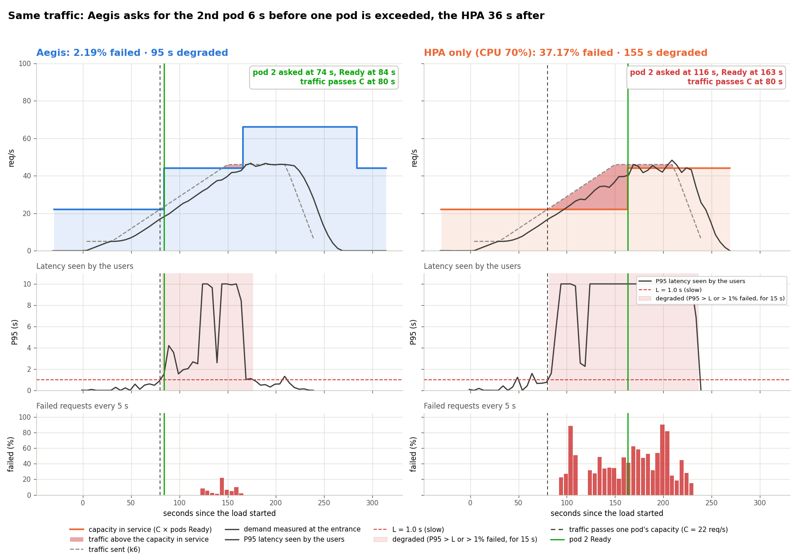

# Aegis

Preventive horizontal scaling for Kubernetes services.

The HPA reacts once the CPU is high, and a new pod still needs seconds to be Ready. Aegis projects the traffic, computes the probability of exceeding the pods' capacity, and raises the HPA's `minReplicas` **before** that happens; it lowers it when traffic drops. Every 5 s:

```
Prometheus ──► demand r ──► projection p = r + m·(T + lag) ──► risk = Φ((p − C·N) / σ) ──► 70% up / 30% for 60 s down ──► HPA minReplicas
```

- **C** (req/s per pod) and **T** (time until a requested pod is Ready) are measured by calibration; **σ** is learned from the projection errors.
- Formulas: [docs/formulas.md](docs/formulas.md) ([español](docs/formulas.es.md)). Dashboard at http://localhost:8080 ([docs/dashboard.md](docs/dashboard.md)).

## Repository

| Path | What it is |
|---|---|
| `app/aegis/collector.py` | Reads demand, latency and Ready pods from Prometheus |
| `app/aegis/risk.py` | Projection, live σ and risk |
| `app/aegis/decision.py` | Scale-up and scale-down rules |
| `app/aegis/actuator.py` | Main loop: applies the decisions to the HPA `minReplicas` (or only publishes them, `metric` mode) |
| `app/aegis/server.py`, `app/aegis/dashboard/` | Dashboard, `/metrics` for Prometheus and the JSON API |
| `app/aegis/replay.py` | Plays a recorded run on the dashboard, without a cluster |
| `app/aegis/calibrate.py`, `calibration.py` | Measure C and T; save and read them in the cluster |
| `app/config.yaml` | Thresholds, queries, calibration, actuator mode and dashboard port |
| `app/tests/` | Unit tests of projection, σ, risk, decisions and server, and a replay of the recorded runs |
| `app/Dockerfile`, `kubernetes/aegis/` | Aegis inside the cluster: image, least-privilege RBAC, Deployment, ServiceMonitor |
| `kubernetes/monitoring/` | Prometheus recording rules (`aegis:catalog_p95_latency`, `aegis:catalog_rps`, `aegis:replica_count`, ...) and alerts |
| `services/catalog-service/`, `shared/proto/` | The service Aegis protects (from MyBookstore): HTTP and gRPC over DynamoDB |
| `kubernetes/catalog-service/`, `dynamodb/` | The service, its Ingress and ServiceMonitor; DynamoDB Local and the table seed |
| `kubernetes/hpa/` | `aegis.yaml` (Aegis writes `minReplicas`), `aegis-metric.yaml` (the HPA reads the Aegis metric) and `baseline.yaml` (plain HPA, CPU 70%) |
| `kubernetes/load/` | k6 traffic profiles |
| `kubernetes/helm/` | Values for Prometheus, prometheus-adapter and Traefik |
| `scripts/setup.sh`, `scripts/check_env.py` | Bring up and check the whole environment |
| `scripts/experiments/` | Campaign, runs, charts, comparison, forecast accuracy, reset |
| `docs/tests/` | The tests, their charts and data ([summary](docs/tests/README.md)) |
| `docs/demo.md` | Step-by-step live demo ([español](docs/demo.es.md)) |

## Getting started (minikube)

Requirements: Docker, minikube, kubectl, helm, Python 3.11+ with `scripts/experiments/requirements.txt` ([new machine](docs/demo.md#1-a-new-machine-from-zero-about-45-minutes-do-it-before-the-class)).

```bash
scripts/setup.sh                 # minikube, metrics-server, Prometheus, Traefik, DynamoDB Local, catalog-service, HPA
cd app
python3 -m aegis.calibrate       # once per environment, ~17 min: measures C and T
python3 -m aegis.actuator        # Aegis, with its dashboard on http://localhost:8080
```

- No cluster: `cd app && python3 -m aegis.replay --speed 5` replays a recorded run.
- Fast machine: `scripts/setup.sh --pod-cpu 60m` keeps C at 20–30 req/s. `--build` rebuilds the service image; `--hpa baseline` runs without Aegis.
- Aegis flags: `--dry-run`, `--log file.ndjson`.
- In the cluster: `scripts/setup.sh --aegis [--hpa aegis-metric]` ([docs/deployment.md](docs/deployment.md)).
- Unit tests: `cd app && python3 -m unittest`.

## Tests

```bash
cd scripts/experiments
python3 preflight.py               # checks everything is in place, and how long the missing runs take
./run_all.sh                       # the whole campaign (~3 h, unattended): 8 tests with 3-5 runs each; resumable
python3 run.py test1-linear-ramp   # or one test only (--runs 5 for repetitions)
python3 report.py                  # charts and tables again from the saved data
python3 compare.py                 # Aegis vs HPA only for each load: docs/tests/comparison.md
python3 forecast_accuracy.py       # the projection against other forecasters: docs/tests/forecast.md
```



Campaign of 2026-10-25, 32 runs, C = 22 req/s, T = 15 s ([all the numbers](docs/tests/comparison.md)):

| Test | Runs | Result |
|---|---|---|
| [Test 1: linear ramp](docs/tests/test1-linear-ramp/), Aegis | 5 | 2nd pod requested 6 s **before** the traffic passes one pod; **2.5%** failed |
| [Test 3: same ramp, HPA only](docs/tests/test3-hpa-baseline/) | 5 | 2nd pod requested 36–65 s **after**; **37.1%** failed |
| [Test 4: spike 5 → 41 req/s in 5 s](docs/tests/test4-spike-aegis/), Aegis | 5 | cannot prevent it, reacts in 11 s; 13.3% failed, 1 unneeded pod per run |
| [Test 5: same spike, HPA only](docs/tests/test5-spike-hpa/) | 5 | reacts in 67–112 s; 54.8% failed |
| [Test 2: two waves](docs/tests/test2-fluctuating/), Aegis | 3 | 1 → 2 → 1 → 2 → 3 → 2 → 1 every run, 0.64% failed |
| [Tests 6 and 7: faster ramps](docs/tests/test6-ramp-045/) (0.41 and 0.46 req/s per s), Aegis | 3 + 3 | the request reaches the crossing itself; 1–2% failed |
| [Test 8: metric mode](docs/tests/test8-metric-mode/) (HPA reads Aegis through the Custom Metrics API) | 3 | works, but 8–72 s later; 20.2% failed |

Every run also saves a timeline (`run-N-timeline.csv`) with the load, the Aegis decisions, the Kubernetes events and the pod transitions on one clock. Comparison: [docs/tests/comparison.md](docs/tests/comparison.md).

## More documentation

- [Dashboard](docs/dashboard.md)
- [Deployment in the cluster, metrics, Custom Metrics API and HPA](docs/deployment.md)
- [Workload capacity, L and T_d](docs/capacity.md)
- [Operating boundaries, limitations and threats to validity](docs/limitations.md)
- [Business case](docs/business_case.md)
- [Experimental methodology](docs/experiments/methodology.md)
- [References](docs/references.md)
