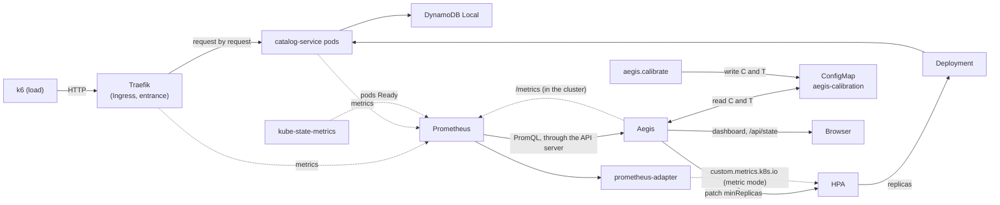
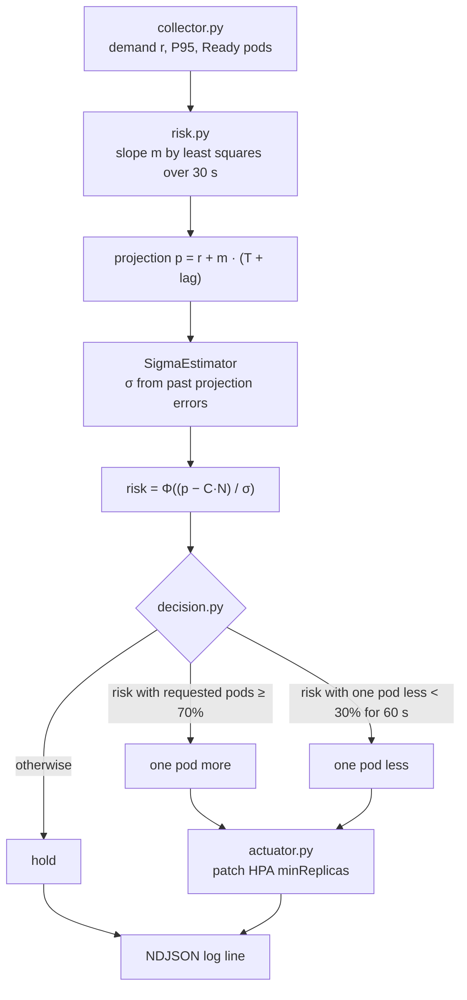
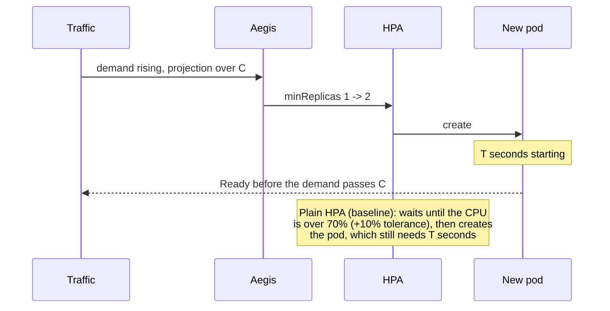

# Architecture Overview

Aegis is a preventive scaling controller. Every 5 s it projects the demand T seconds ahead (T = time a new pod needs to be Ready), computes the probability of exceeding the capacity of the requested pods, and raises or lowers `minReplicas` of the HPA. It moves the HPA's floor earlier than the CPU would; everything else stays standard.

Formulas: [formulas.md](../formulas.md).

## System components

Aegis runs on the laptop or as a Deployment in `aegis-system` ([deployment.md](../deployment.md)). In `min_replicas` mode (default) it patches `minReplicas`; in `metric` mode it only publishes `aegis_target_replicas` and a standard HPA reads it through prometheus-adapter.

## Responsibility boundaries

| Component | Responsibility |
|---|---|
| Traefik | Single entrance for the traffic. Balances request by request across Ready pods and exports request counts, open connections and latency |
| Prometheus | Scrapes Traefik, the pods and kube-state-metrics every 5 s and answers PromQL queries |
| kube-state-metrics | Exposes Deployment and pod state (Ready replicas, pod creation and Ready times) |
| Aegis (`app/aegis/`) | Reads the demand, projects it, calculates the risk, decides the replicas and writes `minReplicas` of the HPA (or publishes it as a metric). Logs every cycle (NDJSON), serves the dashboard and `/metrics` |
| prometheus-adapter | Publishes the Aegis metrics in the Custom Metrics API, attached to the Deployment |
| Calibration (`aegis.calibrate`) | Measures C (capacity of one pod) and T (startup time) with a step load and saves them in a ConfigMap |
| HPA | Keeps the replicas between `minReplicas` and `maxReplicas`. With Aegis its CPU target is 95% (never reached), so Aegis decides; without Aegis it scales on CPU at 70% (baseline) |
| Deployment / ReplicaSet | Creates and removes pods to match the replicas |
| Readiness probe | Marks a pod Ready (`/health`, 5 s timeout); Traefik v3.7 also routes to not-ready pods ([limitations.md](../limitations.md#pod-startup-under-overload)) |

Aegis only reads Prometheus and changes one field of the HPA. If it stops, the HPA keeps the last `minReplicas` and works on its own.

## Aegis internal pipeline

| Stage | File | What it does |
|---|---|---|
| Collect | `collector.py` | Demand at the entrance = completed requests per second + growth of the open connections (Traefik). Also P95 at the entrance and Ready pods |
| Project | `risk.py` | Linear trend over the last 30 s, extrapolated T + 20 s ahead (20 s = measured delay of a 30 s rate) |
| Uncertainty | `risk.py` (`SigmaEstimator`) | Compares every projection with the real traffic when its moment arrives; σ from the errors where traffic came above (5 min window, minimum 1 req/s) |
| Risk | `risk.py` | Probability that the traffic goes over C · N, with a normal projection error |
| Decide | `decision.py` | Up at 70% with the pods already requested; down when the risk with one pod less stays under 30% for 60 s |
| Act | `actuator.py` | Sets `minReplicas` only when it changes; on an API error it retries next cycle |
| Log | `actuator.py` (`--log`) | One JSON line per cycle with every value above |
| Publish | `server.py` | The same cycle on `/api/state` (dashboard) and `/metrics` (Prometheus) |

## Preventive vs reactive scaling

## Key parameters

| Parameter | Meaning | Value | How it is set |
|---|---|---|---|
| L | P95 latency that counts as slow | 1 s | Decided (`config.yaml`, `degradation`) |
| T_d | Time above L that counts as degraded | 15 s | Decided (`config.yaml`, `degradation`) |
| C | req/s one pod serves before degrading | measured | `aegis.calibrate`: step load on 1 pod (22 req/s in the 2026-10-25 campaign) |
| T | Time from asking for a pod until it is Ready | measured | `aegis.calibrate`: raises `minReplicas` and times it (15 s) |
| lag | Delay of the demand measurement | 20 s | Measured once on a real ramp (`config.yaml`, `sampling.metric_lag_seconds`) |
| σ | Projection error | live | `SigmaEstimator`, from the projection errors |
| Thresholds | Scale up / scale down / waiting time | 70% / 30% / 60 s | Decided (`config.yaml`, `risk_thresholds`) |
| Replicas | Range Aegis can request | 1 to 3 | `config.yaml` and `kubernetes/hpa/aegis.yaml` |
