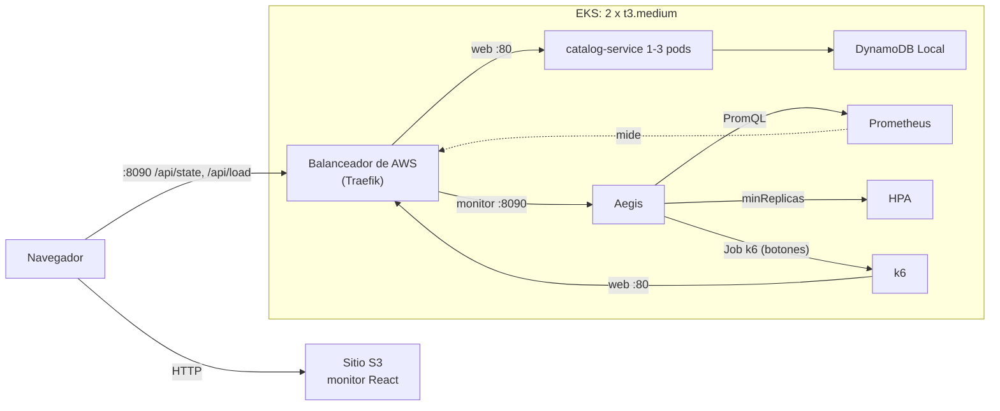

# Aegis en AWS (EKS + S3)

[English](aws.md)

El mismo entorno que en minikube, en un clúster EKS en `us-east-1`, con el monitor como sitio web en S3. Todo por HTTP.



## Antes de empezar

- AWS CLI, `eksctl`, `kubectl`, `helm`, Docker y Node.js en esta máquina, con credenciales de la cuenta (`aws sts get-caller-identity`).
- Un rol IAM existente para el clúster y los nodos (de confianza para `eks.amazonaws.com` y `ec2.amazonaws.com`, con las políticas de clúster EKS, nodo, CNI y lectura de ECR). eksctl lo reutiliza y no crea roles IAM: `export EKS_ROLE=<nombre del rol>`.
- Costo encendido: EKS ~0,10 USD/h + 2 t3.medium ~0,08 USD/h + un balanceador ~0,03 USD/h. **Borrar el clúster al terminar la demo.**

## Levantar todo (~40 min)

```bash
EKS_ROLE=<nombre del rol> scripts/eks_up.sh        # clúster, ~15-20 min
scripts/push_images.sh                             # imágenes a ECR; imprime el registro
scripts/setup.sh --aegis --registry <registro>     # metrics-server, Prometheus, Traefik, DynamoDB, servicio, HPA, Aegis
cd app && python3 -m aegis.calibrate && cd ..      # C y T en EKS, ~17 min (Aegis queda apagado mientras tanto)
scripts/setup.sh --aegis --registry <registro>     # otra vez: ahora Aegis arranca con la calibración
scripts/deploy_monitor.sh                          # monitor en S3, imprime su URL
```

Si C queda fuera de 20-30 req/s, cambiar el CPU del pod (`--pod-cpu`, CPU nuevo ≈ CPU probado × C buscado ÷ C medido) y calibrar otra vez.

La clave de los botones:

```bash
kubectl get secret aegis-load-key -n aegis-system -o jsonpath='{.data.key}' | base64 -d
```

## Seguridad

La API es pública y sin cifrar: `/api/state` solo lee; los botones de carga piden la clave, corren una carga a la vez con tiempo máximo, y solo el origen del monitor puede llamar la API desde un navegador. Del clúster no se expone nada más que `/api/books`.

## Apagar

```bash
scripts/eks_down.sh                                          # clúster y balanceador
aws s3 rb s3://aegis-monitor --force                       # el sitio del monitor, si ya no se usa
```
