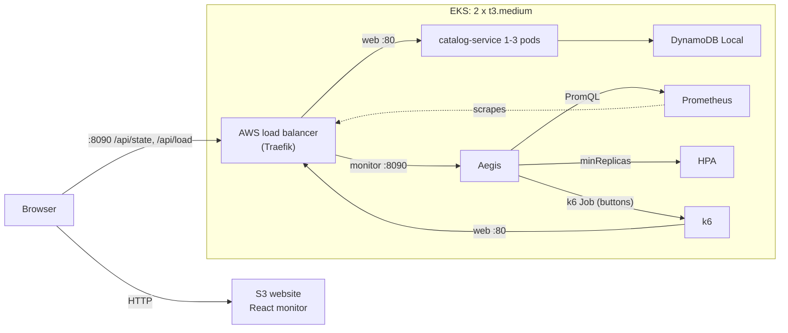

# Aegis on AWS (EKS + S3)

[Español](aws.es.md)

The same environment as on minikube, on an EKS cluster in `us-east-1`, with the monitor as an S3 website. Everything over HTTP.



## Before you start

- AWS CLI, `eksctl`, `kubectl`, `helm`, Docker and Node.js on this machine, with credentials of the account (`aws sts get-caller-identity`).
- One existing IAM role for the cluster and the nodes (trusted by `eks.amazonaws.com` and `ec2.amazonaws.com`, with the EKS cluster, worker node, CNI and ECR read policies). eksctl reuses it and creates no IAM roles: `export EKS_ROLE=<role name>`.
- Cost while on: EKS ~0.10 USD/h + 2 t3.medium ~0.08 USD/h + one load balancer ~0.03 USD/h. **Delete the cluster when the demo ends.**

## Bring everything up (~40 min)

```bash
EKS_ROLE=<role name> scripts/eks_up.sh             # cluster, ~15-20 min
scripts/push_images.sh                             # images to ECR; prints the registry
scripts/setup.sh --aegis --registry <registry>     # metrics-server, Prometheus, Traefik, DynamoDB, service, HPA, Aegis
cd app && python3 -m aegis.calibrate && cd ..      # C and T on EKS, ~17 min (Aegis stays off meanwhile)
scripts/setup.sh --aegis --registry <registry>     # again: now Aegis starts with the calibration
scripts/deploy_monitor.sh                          # monitor on S3, prints its URL
```

If C is outside 20-30 req/s, change the pod CPU (`--pod-cpu`, new CPU ≈ tested CPU × wanted C ÷ measured C) and calibrate again.

The key of the buttons:

```bash
kubectl get secret aegis-load-key -n aegis-system -o jsonpath='{.data.key}' | base64 -d
```

## Security

The API is public and unencrypted: `/api/state` only reads; the load buttons need the key, run one load at a time with a time limit, and only the monitor origin may call the API from a browser. Nothing else of the cluster is exposed besides `/api/books`.

## Turn it off

```bash
scripts/eks_down.sh                                          # cluster and load balancer
aws s3 rb s3://aegis-monitor-<account> --force               # the monitor site, if no longer needed
```
