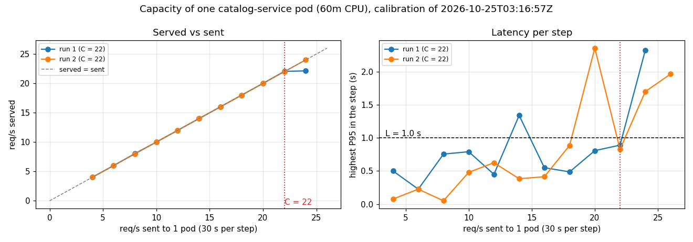

# Capacity, L and T_d

How much traffic one `catalog-service` pod serves before degrading, and the thresholds that define "degraded" (objective OE1 of the [methodology](experiments/methodology.md)).

## Method

`python3 -m aegis.calibrate` pins the HPA to 1 replica and sends a k6 step load through Traefik: from 4 req/s, +2 every 30 s. Every 5 s it reads served rate, entrance P95, errors and Ready pods, skipping the first 10 s of each step. A step is **degraded** when for T_d = 15 s: P95 > L = 1 s, errors > 1%, served < 90% of sent, or no Ready pod. C is the last step before that, the lowest of two runs. Data: `docs/tests/calibration.json` and the ConfigMap `aegis-calibration`.

Environment: minikube on an 8-core laptop, pod limit **60m CPU** / 256 Mi (with 200m one pod served 80+ req/s), 2026-10-25.

## Results

| Sent (req/s) | Run 1: served | Run 1: highest P95 (s) | Run 2: served | Run 2: highest P95 (s) |
|---:|---:|---:|---:|---:|
| 4 | 4.00 | 0.50 | 4.00 | 0.07 |
| 6 | 6.00 | 0.23 | 6.00 | 0.23 |
| 8 | 8.05 | 0.76 | 8.00 | 0.05 |
| 10 | 10.00 | 0.79 | 10.00 | 0.48 |
| 12 | 12.00 | 0.45 | 12.00 | 0.62 |
| 14 | 14.00 | 1.34 | 14.00 | 0.38 |
| 16 | 16.00 | 0.55 | 16.00 | 0.41 |
| 18 | 18.00 | 0.49 | 18.00 | 0.89 |
| 20 | 20.00 | 0.81 | 20.00 | 2.36 |
| 22 | 22.05 | 0.89 | 22.00 | 0.83 |
| 24 | 22.13 | 2.33 | 24.00 | 1.70 |
| 26 | – | – | – | 1.97 |

Both runs degraded at 24 req/s (served < 90%): **C = 22 req/s**.

- **Knee**: the pod follows the sent rate up to 22 req/s; at 24 it serves ~22 and queues the rest.
- **Isolated spikes** at 14 and 20 req/s lasted less than T_d and recovered: the reason T_d exists.
- **Variation**: in 2 of 5 runs of test 1 the single pod degraded at ~17 req/s. C is an average; σ and the 70% threshold are the margin.
- **T = 15 s**: raising `minReplicas` 1 → 3 at idle, both pods were Ready 14.1 s after the request. Under overload it takes much longer ([limitations.md](limitations.md#pod-startup-under-overload)).

The first evaluation (other machine, 200m, 2026-10-19) measured C = 24 and T = 15 s.

## Agreed values

| Parameter | Value | Why |
|---|---|---|
| L (P95 threshold) | **1 s** | Below the knee P95 stays under 0.9 s; past it, 1.7–2.3 s and climbing. Traefik has a histogram bucket at 1 s, so it is not interpolated. |
| T_d (sustained time) | **15 s** | Three scrapes; one or two slow samples are noise. Equal to T: shorter degradations cannot be fixed by scaling. |
| C (capacity per pod) | **22 req/s** | Measured; depends on CPU limit, code, database and node, so recalibrate per machine. |
| T (pod startup) | **15 s** | Measured above. |

L and T_d are in `app/config.yaml` (`degradation`), C and T in the calibration ConfigMap. σ is learned live ([formulas.md](formulas.md#5-sigma-learned-from-the-projections-own-errors)).

Recording rules for these signals: [deployment.md](deployment.md#recording-rules).
