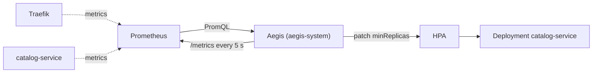

# Deployment


| | On the laptop (default) | In the cluster (`scripts/setup.sh --aegis`) |
|---|---|---|
| Start | `cd app && python3 -m aegis.actuator` | Deployment `aegis` in `aegis-system` |
| Prometheus | API server proxy | `http://prometheus-kube-prometheus-prometheus.monitoring.svc:9090` |
| Credentials | `~/.kube/config` | ServiceAccount `aegis` |
| API (`/api/state`, `/api/load`) | http://localhost:8080 | Traefik entrypoint `monitor`, port 8090 (`kubernetes/aegis/ingress.yaml`) |
| `/metrics` scraped | no | yes (ServiceMonitor `aegis`) |

Run only one Aegis at a time. `setup.sh` without `--aegis` scales the in-cluster one to 0.

```bash
scripts/setup.sh                                    # cluster, Prometheus, Traefik, service, HPA
cd app && python3 -m aegis.calibrate && cd ..       # once per machine
scripts/setup.sh --aegis                            # Aegis in the cluster
scripts/setup.sh --aegis --build                    # rebuild aegis:local after changing app/
```

`--aegis` builds `aegis:local` in minikube, creates the ConfigMap `aegis-config` from `app/config.yaml` and applies `kubernetes/aegis/`.



## RBAC

In `default`:

| Resource | Verbs | Why |
|---|---|---|
| `horizontalpodautoscalers` | get, list, watch, patch | limits, status, `minReplicas` |
| `deployments` | get, list | selector, calibration fingerprint |
| `pods`, `endpoints`, `services` | get, list | Ready pods |
| `configmaps` `aegis-calibration` | get | C and T |
| `jobs` and `configmaps` `aegis-load` | create, get, update, delete | the k6 load of the monitor buttons |

Cluster-wide only `nodes: get`. Calibration runs from the laptop with your credentials (it creates Jobs and writes the ConfigMap).

```bash
SA=system:serviceaccount:aegis-system:aegis
kubectl auth can-i patch hpa/catalog-service -n default --as $SA   # yes
kubectl auth can-i delete pods -n default --as $SA                 # no
kubectl auth can-i list pods -n kube-system --as $SA               # no
```

Verified on 2026-10-25: yes for patch hpa, get the calibration ConfigMap, list pods, get deployments and nodes; no for delete/create pods (the load Job is the only thing it creates), patch deployments, secrets, other ConfigMaps and `kube-system`.

## Metrics

`GET /metrics`, one value per cycle, labels `target_namespace` and `target_deployment`.

| Metric | Meaning |
|---|---|
| `aegis_demand_rps` | r |
| `aegis_slope_rps_per_second` | m over the last 30 s |
| `aegis_projected_rps` | p = r + m·(T + lag) |
| `aegis_sigma_rps` | σ |
| `aegis_risk` | Φ((p − C·N)/σ) with the requested replicas |
| `aegis_risk_one_less` | the same with one less |
| `aegis_target_replicas` | replicas Aegis wants |
| `aegis_applied_min_replicas` | last `minReplicas` written |
| `aegis_replicas_ready`, `aegis_capacity_rps`, `aegis_p95_seconds` | cycle inputs |
| `aegis_hpa_desired_replicas`, `aegis_hpa_current_replicas` | HPA status |
| `aegis_pod_capacity_rps`, `aegis_startup_time_seconds` | C and T |
| `aegis_risk_threshold_scale_up`, `aegis_risk_threshold_scale_down` | 0.70, 0.30 |
| `aegis_decisions_total{action}`, `aegis_cycles_total`, `aegis_failed_applies_total` | counters |
| `aegis_last_cycle_timestamp_seconds` | staleness |

Also `/healthz`, `/readyz` (a cycle in the last 20 s), `/api/state` (JSON for the monitor) and `/api/load`:

| Call | What it does |
|---|---|
| `GET /api/load` | profiles (ramp, spike, waves: rates as multiples of C), the running load, whether the buttons are on |
| `POST /api/load {"profile": "ramp"}` | starts that k6 Job; needs `X-Aegis-Key` (Secret `aegis-load-key`); 409 if another load runs |
| `DELETE /api/load` | stops the load; needs the key |

Browsers may call the API only from `server.allowed_origins` (`AEGIS_ALLOWED_ORIGIN`, ConfigMap `aegis-monitor`).

## Prometheus

UI: `kubectl port-forward -n monitoring svc/prometheus-kube-prometheus-prometheus 9090`. Check everything with `python3 scripts/check_env.py`.
