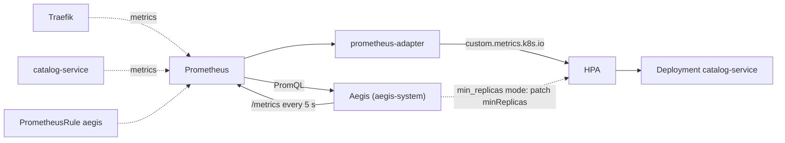

# Deployment

| | On the laptop (default) | In the cluster (`scripts/setup.sh --aegis`) |
|---|---|---|
| Start | `cd app && python3 -m aegis.actuator` | Deployment `aegis` in `aegis-system` |
| Prometheus | API server proxy | `http://prometheus-kube-prometheus-prometheus.monitoring.svc:9090` |
| Credentials | `~/.kube/config` | ServiceAccount `aegis` |
| Dashboard | http://localhost:8080 | `kubectl port-forward -n aegis-system svc/aegis 8080` |
| `/metrics` scraped | no | yes (ServiceMonitor `aegis`) |

| Actuator mode | HPA manifest | Who writes to the API |
|---|---|---|
| `min_replicas` (default) | `kubernetes/hpa/aegis.yaml` | Aegis patches `minReplicas` |
| `metric` | `kubernetes/hpa/aegis-metric.yaml` | only the HPA, reading `aegis_target_replicas` from the Custom Metrics API |

Run only one Aegis at a time. `setup.sh` without `--aegis` scales the in-cluster one to 0.

```bash
scripts/setup.sh                                    # cluster, Prometheus, rules, prometheus-adapter, Traefik, service, HPA
cd app && python3 -m aegis.calibrate && cd ..       # once per machine
scripts/setup.sh --aegis                            # Aegis in the cluster, min_replicas mode
scripts/setup.sh --aegis --hpa aegis-metric         # metric mode
scripts/setup.sh --aegis --build                    # rebuild aegis:local after changing app/
```

`--aegis` builds `aegis:local` in minikube, creates the ConfigMap `aegis-config` from `app/config.yaml` and applies `kubernetes/aegis/`. The mode comes from the env var `AEGIS_ACTUATOR_MODE`.



## RBAC

In `default`:

| Resource | Verbs | Why |
|---|---|---|
| `horizontalpodautoscalers` | get, list, watch, patch | limits, status, `minReplicas` |
| `deployments` | get, list | selector, calibration fingerprint |
| `pods`, `endpoints`, `services` | get, list | Ready pods |
| `configmaps` `aegis-calibration` | get | C and T |

Cluster-wide only `nodes: get`. Calibration runs from the laptop with your credentials (it creates Jobs and writes the ConfigMap).

```bash
SA=system:serviceaccount:aegis-system:aegis
kubectl auth can-i patch hpa/catalog-service -n default --as $SA   # yes
kubectl auth can-i delete pods -n default --as $SA                 # no
kubectl auth can-i list pods -n kube-system --as $SA               # no
```

Verified on 2026-10-25: yes for patch hpa, get the calibration ConfigMap, list pods, get deployments and nodes; no for delete/create pods, patch deployments, secrets, other ConfigMaps and `kube-system`.

## Metrics

`GET /metrics`, one value per cycle, labels `target_namespace` and `target_deployment`.

| Metric | Meaning |
|---|---|
| `aegis_demand_rps` | r |
| `aegis_slope_rps_per_second` | m over the last 30 s |
| `aegis_projected_rps` | p = r + m·(T + lag) |
| `aegis_sigma_rps` | σ |
| `aegis_risk` | Φ((p − C·N)/σ) with the requested replicas |
| `aegis_risk_one_less` | the same with one less |
| `aegis_target_replicas` | replicas Aegis wants (followed by the metric-mode HPA) |
| `aegis_applied_min_replicas` | last `minReplicas` written |
| `aegis_replicas_ready`, `aegis_capacity_rps`, `aegis_p95_seconds` | cycle inputs |
| `aegis_hpa_desired_replicas`, `aegis_hpa_current_replicas` | HPA status |
| `aegis_pod_capacity_rps`, `aegis_startup_time_seconds` | C and T |
| `aegis_risk_threshold_scale_up`, `aegis_risk_threshold_scale_down` | 0.70, 0.30 |
| `aegis_decisions_total{action}`, `aegis_cycles_total`, `aegis_failed_applies_total` | counters |
| `aegis_last_cycle_timestamp_seconds` | staleness |

Also `/healthz`, `/readyz` (a cycle in the last 20 s) and `/api/state` (dashboard JSON).

## Custom Metrics API and metric mode

prometheus-adapter maps `target_namespace`/`target_deployment` to the Deployment, so the metrics belong to `catalog-service`:

```bash
kubectl get --raw /apis/custom.metrics.k8s.io/v1beta1/namespaces/default/deployments.apps/catalog-service/aegis_risk | jq '.items[0].value'
```

`aegis-metric.yaml` uses an `Object` metric with `averageValue: 1`, so `desired = ceil(aegis_target_replicas)`; CPU 95% stays as a safety net. Scale-up: no window, up to 2 pods per 15 s. Scale-down: 30 s window, 1 pod per 30 s, so one stale sample never removes a pod. To scale in faster, lower `risk_thresholds.scale_down_sustained_seconds` instead of the HPA window.

The metric path (scrape, adapter, HPA sync) delayed decisions by 8–72 s in test 8, which cost the lead time ([limitations.md](limitations.md#3-metric-mode)).

## Recording rules

Evaluated every 5 s (`kubernetes/monitoring/recording-rules.yaml`):

| Rule | Meaning |
|---|---|
| `aegis:catalog_p95_latency` (`:by_pod`) | service P95 without `/health` and `/metrics` |
| `aegis:catalog_rps` (`:by_pod`) | requests served per second |
| `aegis:replica_count` | Ready replicas |
| `aegis:catalog_rps_per_replica` | rps / replicas |
| `aegis:entrypoint_demand_rps`, `aegis:entrypoint_p95_latency`, `aegis:entrypoint_error_ratio` | what Aegis reads at Traefik |

Alerts: `AegisStalled` (no cycle for 30 s), `AegisCannotUpdateHpa`.

```promql
aegis:catalog_p95_latency > 1                                 # degraded
aegis:catalog_rps_per_replica / on() aegis_pod_capacity_rps   # pod load as a fraction of C
aegis_target_replicas - on() aegis:replica_count              # requested, not Ready yet
```

UI: `kubectl port-forward -n monitoring svc/prometheus-kube-prometheus-prometheus 9090`. Check everything with `python3 scripts/check_env.py`.
