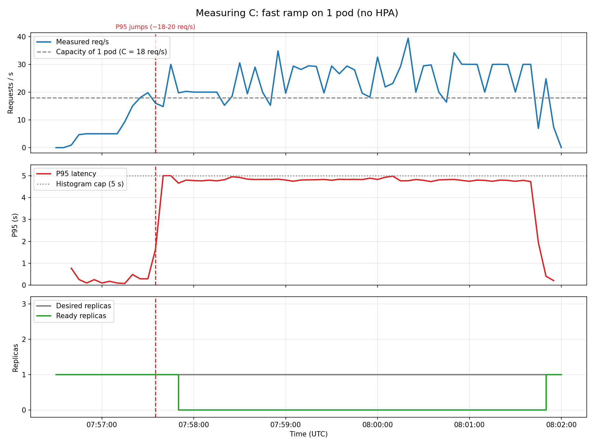

# 01 — Capacity of one pod ($C$)

**Date:** 2026-09-27, 07:56:30 – 08:02:00 UTC
**Goal:** find how many requests per second one `catalog-service` pod handles before it slows down.

## Setup
- 1 replica of `catalog-service` (limit 200m CPU / 256Mi), no HPA.
- k6 inside the cluster against `GET /api/books` (Scan of 50 books in DynamoDB Local).
- Traffic: about 30 s at 5 req/s, then a fast climb to ~30 req/s, held for about 4 minutes.

## Results

| Time | req/s | P95 |
|---|---|---|
| 07:57:30 | 19.8 | 0.29 s (healthy) |
| 07:57:35 | 16.0 | 1.64 s |
| 07:57:40 | 14.8 | 5.0 s (histogram cap) |

- It is not a gradual degradation but a **cliff**: healthy up to ~18–20 req/s and broken right after.
- According to the day 5 notes, k6 measured the P95 jump from 0.29 s to 5.00 s between 18.9 and 22.4 req/s, with 30.5% timeouts.
- The saturated pod stopped passing its readiness probe: 0 Ready replicas between 07:57:50 and 08:02:00.

**Conclusion: C = 18 req/s.**

## Notes
- The req/s that seem to drop while the pod is broken are an effect of saturation, not less traffic: the pod serves less than what arrives.
- P95 stays flat at 5 s because that is the highest bucket in the `catalog-service` histogram.
- Data recovered from Prometheus on 2026-09-28 with `export_run.py` (`data/capacity-calibration.csv`).
