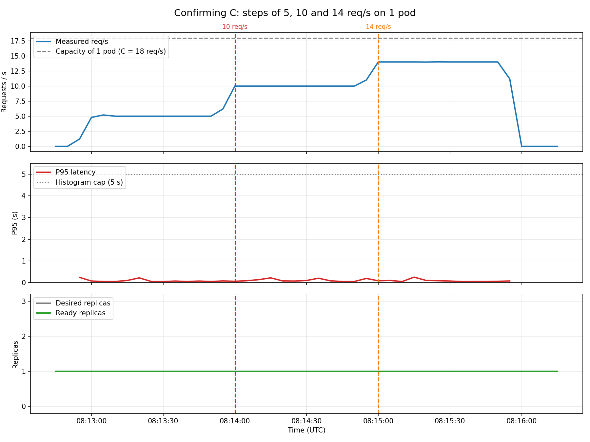

# 02 — Steps below capacity (confirming $C$ and $\sigma$)

**Date:** 2026-09-27, 08:12:45 – 08:16:15 UTC
**Goal:** confirm the service is healthy below $C$, and see how much the traffic varies.

## Setup
- 1 replica, no HPA.
- k6 (`kubernetes/k6/test.js`): 1 minute at 5 req/s, 1 minute at 10 and 1 minute at 14.

## Results

| Step | Measured req/s | P95 |
|---|---|---|
| 5 req/s | 5.0 | 0.05 – 0.22 s |
| 10 req/s | 10.0 | 0.05 – 0.22 s |
| 14 req/s | 14.0 | 0.05 – 0.25 s |

**Conclusion:** up to 14 req/s the service is healthy, which confirms the limit is above that (C = 18).

## About $\sigma$
Calculated with `scripts/measure_sigma.py` (standard deviation of req/s over a window):
- Over a stable traffic window it gives **0.13 req/s**: k6 synthetic traffic barely varies.
- If the window includes the ramp climb it gives **6.07 req/s**, but that measures the climb, not the noise.

**σ = 2 req/s** was chosen as a middle value, because real traffic varies more than k6 traffic.
