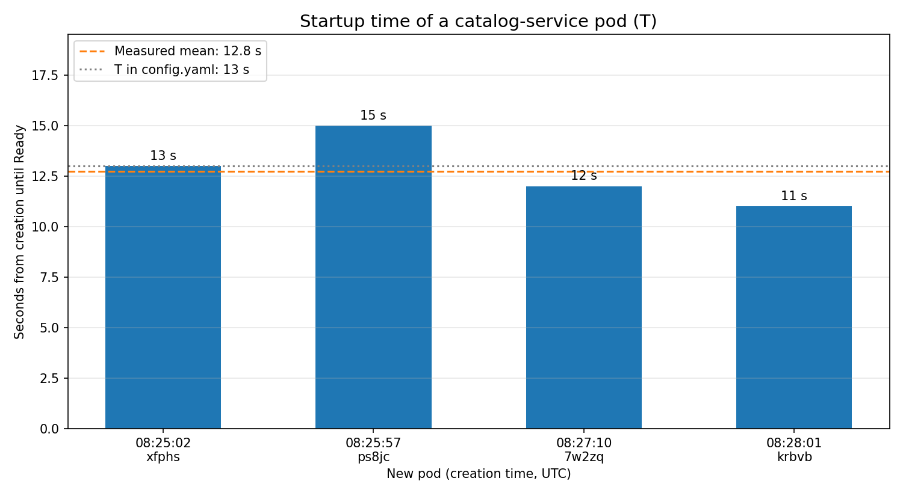

# 03 — Startup time of a pod ($T$)

**Date:** 2026-09-27, 08:25 – 08:28 UTC
**Goal:** measure how long a new `catalog-service` pod takes from creation until it can receive traffic (Ready). That is Aegis's prediction horizon.

## Setup
- Manual scaling of the Deployment (`kubectl scale`), four times.
- Times taken from kube-state-metrics in Prometheus: `kube_pod_created` and `kube_pod_status_ready_time`.

## Results

| Pod | Created | Until Ready |
|---|---|---|
| `...xfphs` | 08:25:02 | 13 s |
| `...ps8jc` | 08:25:57 | 15 s |
| `...7w2zq` | 08:27:10 | 12 s |
| `...krbvb` | 08:28:01 | 11 s |

Mean 12.8 s, min 11 s, max 15 s.

**Conclusion: T = 13 s.**

## Notes
- In test 04, with the node under load, the second replica took 26 s. In test 07 it took 13 s. Under heavy load $T$ can be longer.
- Chart generated on 2026-09-28 with `scripts/plot_startup.py 2026-09-27T08:24:00Z 2026-09-27T08:30:00Z`.
