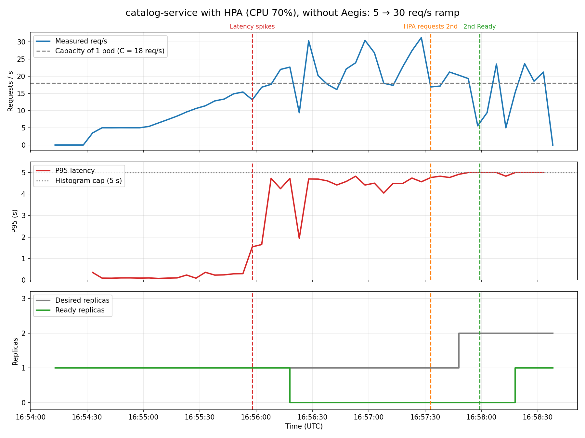

# 04 — Baseline HPA, without Aegis ("before" comparison)

**Date:** 2026-09-28, 16:54:13 – 16:58:41 UTC
**Goal:** see how Kubernetes reacts on its own to a traffic ramp that exceeds the capacity of one pod.

## Setup
- `metrics-server` enabled in minikube.
- HPA (`kubernetes/catalog-service-hpa.yaml`): CPU at 70%, 1 to 3 replicas.
- k6 (`kubernetes/k6-ramp-demo/`): 30 s at 5 req/s, 2 min climbing from 5 to 30, 1 min at 30 and 30 s down to 5.

## Results

| Moment | Time | What happened |
|---|---|---|
| Latency spikes | 16:55:58 | P95 from 0.29 s to 1.54 s (~15 req/s), and to 4.7 s shortly after |
| HPA requests the 2nd replica | 16:57:33 | **95 s after** latency broke |
| 2nd replica becomes Ready | 16:57:59 | 26 s after being requested |

k6 summary: 4113 requests, real P95 10.4 s, max 22 s, **6.15% failed**, 461 dropped iterations.

## Why the HPA is late
- The CPU the HPA sees updates every ~60 s: it went from 33% to 73% and then to 90%.
- The HPA has a 10% tolerance, so 73% against 70% is not enough to scale. It only scaled at 90%.
- The saturated pod stopped answering `/health` in time and there were **0 Ready replicas** for ~2 minutes.

**Conclusion:** those 95 s with a slow service are the gap Aegis has to close.

## Notes
- The replica steps in the chart arrive ~15–20 s after the vertical lines because Prometheus samples with a delay. The correct times are the lines, taken from Kubernetes events.
- Generated with `export_run.py` and `plot_run.py`.
