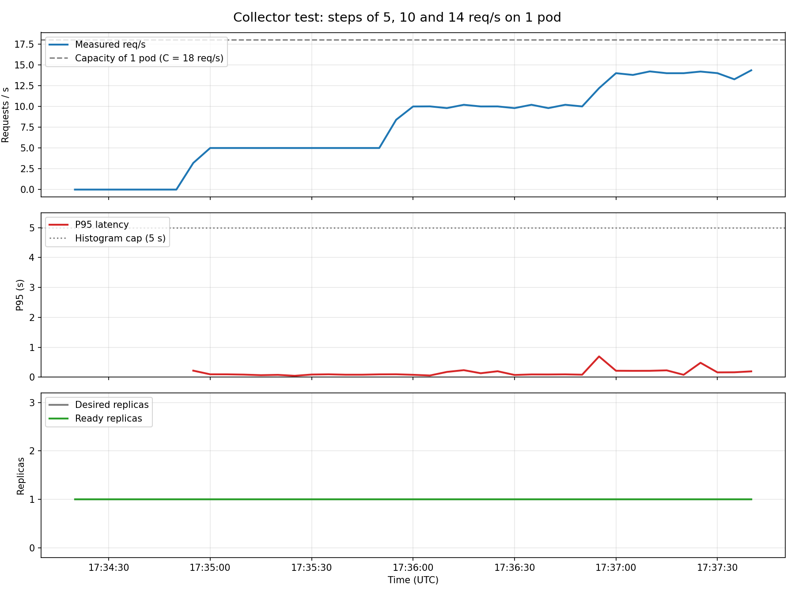

# 05 — Collector (`app/aegis/collector.py`)

**Date:** 2026-09-28
**Goal:** check that the collector reads from Prometheus the same metrics the real traffic produces, and that it does not crash if Prometheus fails.

## Test A: with real traffic
**Time:** 17:34:22 – 17:37:37 UTC

- Collector running from the local machine through the port-forward: `AEGIS_PROMETHEUS_URL=http://localhost:9090 python3 -m aegis.collector`
- At the same time, the k6 step test (`kubernetes/k6/`): 5, 10 and 14 req/s, 1 minute each.

| Step | What the collector read |
|---|---|
| No traffic | rps = 0.0, empty P95 (no requests), 1 replica |
| 5 req/s | rps = 5.0, P95 0.08 – 0.09 s |
| 10 req/s | rps = 10.0, P95 0.09 – 0.18 s |
| 14 req/s | rps = 14.0, P95 0.20 – 0.28 s |

It took one sample every 5 s without drifting. The transition between steps takes ~20 s to fully show because the query uses a 30 s window.

## Test B: Prometheus down
**Time:** ~17:41:54 UTC

- Collector pointed at a port with nothing listening (`http://localhost:9999`).
- Result: it logs a `WARNING` for each query, returns the sample with empty values (`-`) and **keeps running**.

**Conclusion:** the collector works with real data and tolerates network errors.
