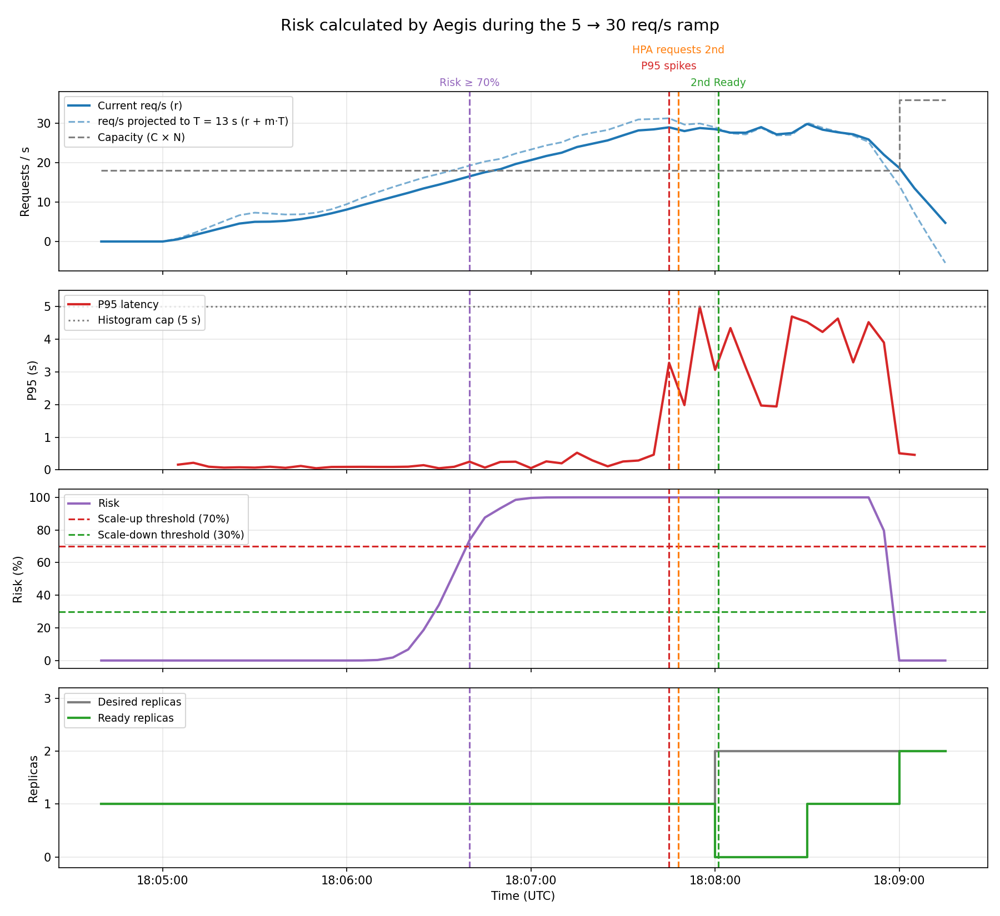

# 07 — Risk calculator, live (`app/aegis/risk.py`)

**Date:** 2026-09-28, 18:04:40 – 18:09:15 UTC
**Goal:** see whether the risk rises **before** latency breaks, with real traffic.

## Setup
- Calculator running from the local machine: `AEGIS_PROMETHEUS_URL=http://localhost:9090 python3 -m aegis.risk`
- The same ramp as test 04 (`kubernetes/k6-ramp-demo/`, 5 → 30 req/s).
- The HPA from test 04 was still active (CPU 70%). Aegis **only calculates** at this point; it does not scale anything.

## Results

| Moment | Time | What happened |
|---|---|---|
| Risk crosses 70% | 18:06:40 | 16.6 req/s, projection to 13 s: 19.3 req/s → **risk 73.8%**. This is where Aegis would request the replica |
| Latency spikes | 18:07:45 | P95 from 0.47 s to 3.28 s |
| HPA requests the 2nd replica | 18:07:48 | On its own, already late |
| 2nd replica becomes Ready | 18:08:01 | 13 s after creation (same as $T$) |

**Conclusion:** risk crossed the threshold **65 s before** latency broke. Since a pod takes ~13 s to be ready, Aegis would have had the second replica serving about 50 s before the service slowed down.

## Notes
- This time the pod held up to ~28 req/s before breaking, not ~18–20 as in test 01. Real capacity varies between runs. C = 18 is conservative, which makes Aegis act a bit earlier.
- With the service saturated, the slope gets noisy (between −0.13 and +0.08), but risk stays above 90%.
- At the end, when 2 replicas are Ready, capacity rises to 36 and risk drops to 0%.
- The chart was rebuilt with `scripts/replay_risk.py`, which feeds the Prometheus data back through the same calculator. It matches what the live calculator printed (e.g. 18:06:40 → 16.56 req/s, 73.8% in both).
- Ready replicas drops to 0 around 18:08: the original pod stopped passing its readiness probe due to saturation and became Ready again at 18:08:47.
