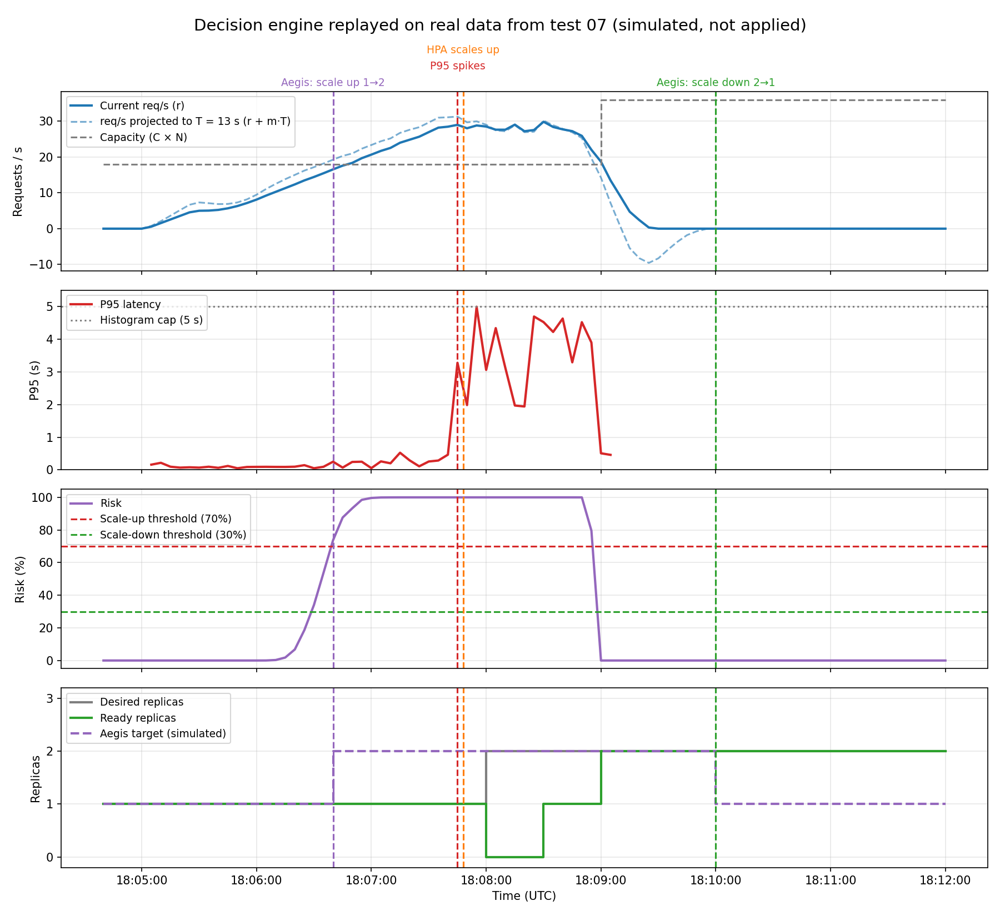

# 09 — Decision engine replayed on real data (`app/aegis/decision.py`)

**Date:** 2026-09-28 (data from test 07: 18:04:40 – 18:12:00 UTC)
**Goal:** see what Aegis would have decided during a real traffic ramp, and when, compared with the HPA.

## Setup
- No new traffic: the Prometheus data from test 07 (5 → 30 req/s ramp, HPA at CPU 70%) was fed through the risk calculator and the decision engine, sample by sample.
- `scripts/replay_risk.py 2026-09-28T18:04:40Z 2026-09-28T18:12:00Z docs/tests/data/decision-replay`
- The decisions are **simulated**: nothing was applied to Kubernetes. The real replicas in the chart are the ones the HPA created on its own.

## Results

| Moment | Time | What happened |
|---|---|---|
| Aegis would scale up 1 → 2 | 18:06:40 | Risk with 1 replica 73.8% (16.6 req/s, projected 19.3) |
| Latency spikes | 18:07:45 | P95 from 0.47 s to 3.28 s |
| HPA scales up 1 → 2 | 18:07:48 | On its own |
| Aegis would scale down 2 → 1 | 18:10:00 | Risk with 1 replica 0.0% for 60 s (traffic ended ~18:09:15) |

- Aegis would have asked for exactly **one** extra replica, **65 s before** latency broke and 68 s before the HPA.
- With T ≈ 13 s, the second pod would have been Ready around 18:06:53, almost a minute before the spike.
- Aegis would have scaled back down 60 s after risk became low, as the plan's hysteresis rule says.

**Conclusion:** on real data, the engine makes the right decisions at the right time. The next step is the actuator, so these decisions are actually applied.

## Notes
- This is a replay, not a live test: we cannot know what latency would have been if the second pod had really started at 18:06:40. The live proof comes when the actuator is connected.
- The projected req/s goes below 0 while traffic stops (the slope is very negative). It is harmless: risk is 0% either way.
