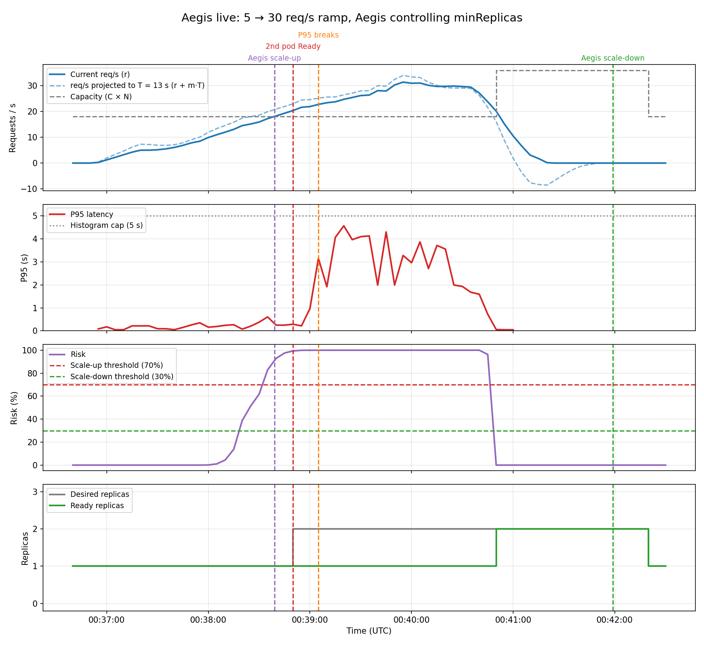
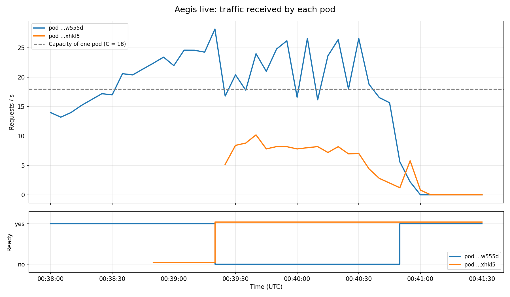

# 11 — Aegis live, controlling the HPA ("after" comparison)

**Date:** 2026-10-14, 00:36:43 – 00:42:27 UTC
**Goal:** run the same ramp as test 04, now with Aegis really scaling, and see whether the second pod arrives before latency breaks.

## Setup
- Full Aegis loop from the local machine: `AEGIS_PROMETHEUS_URL=http://localhost:9090 python3 -m aegis.actuator`
- HPA for Aegis (`kubernetes/catalog-service-hpa-aegis.yaml`): CPU at 95% so it does not scale by itself, no scale-down window, 1 to 3 replicas.
- k6 (`kubernetes/k6-ramp-demo/`), same ramp as test 04: 30 s at 5 req/s, 2 min from 5 to 30, 1 min at 30, 30 s down to 5. k6 ran from 00:36:53 to 00:40:56.
- A first attempt at ~00:31 UTC sent no traffic: the k6 pod could not pull `grafana/k6:latest` from Docker Hub. Both k6 Jobs now use `imagePullPolicy: IfNotPresent`.

## Results

| Moment | Time (UTC) | What happened |
|---|---|---|
| Aegis scales up 1 → 2 | 00:38:39 | 17.2 req/s, risk 82.9%. `minReplicas` set to 2 |
| 2nd pod Ready | 00:38:50 | 11 s after being created (`kube_pod_status_ready_time`) |
| Latency breaks | 00:39:05 | P95 from 0.22 s to 3.15 s at ~23 req/s |
| Traffic ends | 00:40:56 | k6 Job completed |
| Aegis scales down 2 → 1 | 00:41:59 | Risk with 1 replica 0% for 65 s |

Aegis asked for the second pod **26 s before** latency broke, and the pod was Ready **15 s before**. Even so, latency broke.

### Comparison with test 04

| | Test 04 (HPA only) | Test 11 (Aegis) |
|---|---|---|
| 2nd replica requested | 95 s **after** latency broke | 26 s **before** |
| 2nd replica Ready | after latency broke | 15 s before |
| k6 P95 / max | 10.4 s / 22 s | 4.6 s / 8.7 s |
| Failed requests | 6.15% | **0%** (0 of 4554) |
| Dropped iterations | 461 | 20 |
| Time with 0 Ready replicas | ~2 min | never |

## Why latency still broke: traffic was not split between the pods

Each pod counts its own requests. With 2 pods serving, the old pod kept getting **16–28 req/s**, above its capacity of 18. The new pod only got **~8 req/s**, and it only started getting traffic around 00:39:25, more than 30 s after it was Ready.

The cause is how the traffic reaches the pods. k6 keeps each connection open and sends many requests through it (keep-alive). A Kubernetes Service picks a pod only when a **new connection** opens, not per request. The connections opened before the scale-up all went to the only pod there was, and they stayed there. The new pod only got the few new connections k6 opened later. The old pod was even taken out of the Service for failing its readiness probe, but its open connections kept bringing it traffic.

So Aegis did its part on time: it predicted the overload and the capacity was there before latency broke. What failed is that the load was not spread across that capacity.

## Conclusion
- Aegis scaled up before latency broke and scaled down 65 s after traffic ended, with no flapping.
- Compared with the HPA alone: 0% errors instead of 6.15%, P95 cut by more than half, and the service never had 0 Ready replicas.
- Latency still broke because of keep-alive connections staying on the old pod. That has to be fixed for the demo; it is a load balancing problem, not an Aegis one.

## Notes
- The Ready replicas in the main chart come from kube-state-metrics, which shows changes ~20–30 s late (same as in test 04). The exact Ready time of the new pod (00:38:50) comes from `kube_pod_status_ready_time`.
- This time latency broke at ~23 req/s, earlier than in test 07 (~28). The real breaking point changes between runs, so the head start Aegis gets changes too (65 s in test 07, 26 s here).
- Chart and data: `replay_risk.py` + `plot_risk.py --hide-target` (`data/aegis-live.*`). The replay finds the same decisions as the live log, 4–9 s earlier because it samples at different instants. Traffic per pod: new `scripts/plot_pods.py` (`data/aegis-live-pods.*`).
