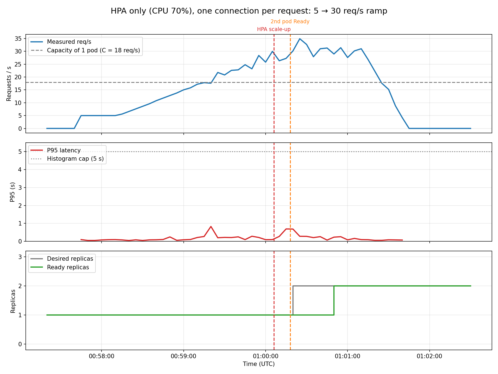
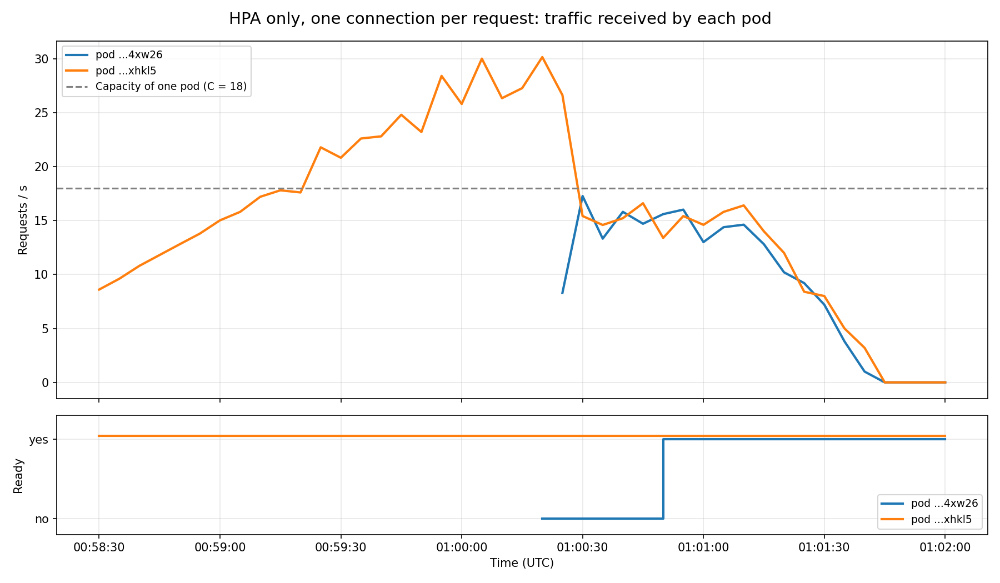

# 12 — Baseline HPA again, one connection per request

**Date:** 2026-10-14, 00:57:33 – 01:01:40 UTC
**Goal:** repeat test 04 (HPA only, no Aegis) with the load-balancing fix from test 11, so tests 04 and 11 can be repeated with the same traffic.

## Setup
- Baseline HPA again (`kubernetes/catalog-service-hpa.yaml`): CPU at 70%, 1 to 3 replicas, default 5-minute scale-down window. Aegis not running.
- k6 (`kubernetes/k6-ramp-demo/`), same ramp as test 04, with one change: `noConnectionReuse: true`. Every request opens a new connection, so the Service can send each request to any Ready pod.

## Results

| Moment | Time (UTC) | What happened |
|---|---|---|
| Traffic passes 18 req/s | ~00:59:25 | P95 stays at 0.2 s |
| Traffic at ~28 req/s, still 1 pod | 01:00:05 | P95 0.1 s |
| HPA requests the 2nd replica | 01:00:06 | CPU above 70% (77% needed with the 10% tolerance) |
| 2nd pod Ready | 01:00:18 | 12 s after being requested |

k6 summary: 4574 requests, **P95 0.94 s**, max 1.68 s, **0% failed**, 0 dropped iterations.

With 2 pods, traffic was split evenly: about 13–17 req/s each. The fix works.

### Comparison with test 04

| | Test 04 (keep-alive) | Test 12 (one connection per request) |
|---|---|---|
| Latency breaks | at ~15–17 req/s | **never** |
| k6 P95 / max | 10.4 s / 22 s | 0.94 s / 1.68 s |
| Failed requests | 6.15% | 0% |
| Highest traffic on 1 pod without breaking | ~15 req/s | **~28 req/s** |

## Conclusion
- The load-balancing fix works: after the scale-up, both pods get the same traffic.
- But one pod alone handled up to ~28 req/s with a healthy P95. With keep-alive it broke at 15–23 req/s (tests 01, 04, 11). So **C = 18 was measured with keep-alive traffic and does not hold with this traffic**.
- With this traffic the 5 → 30 req/s ramp does not overload one pod, so there is no problem for Aegis to prevent. Before repeating test 11, $C$ has to be measured again with one connection per request, and the demo ramp may need a higher peak.

## Notes
- Why one pod handles more without keep-alive is not clear yet. CPU per request looked similar in both modes (~0.17 cores near 16–20 req/s), but Prometheus only had a few CPU samples, so this is not conclusive.
- The P95 peaks of ~0.7–0.8 s near 00:59:20 and 01:00:15 are short and the service recovers on its own.
- Generated with `export_run.py`, `plot_run.py` and `plot_pods.py` (`data/hpa-baseline-no-reuse*`).
