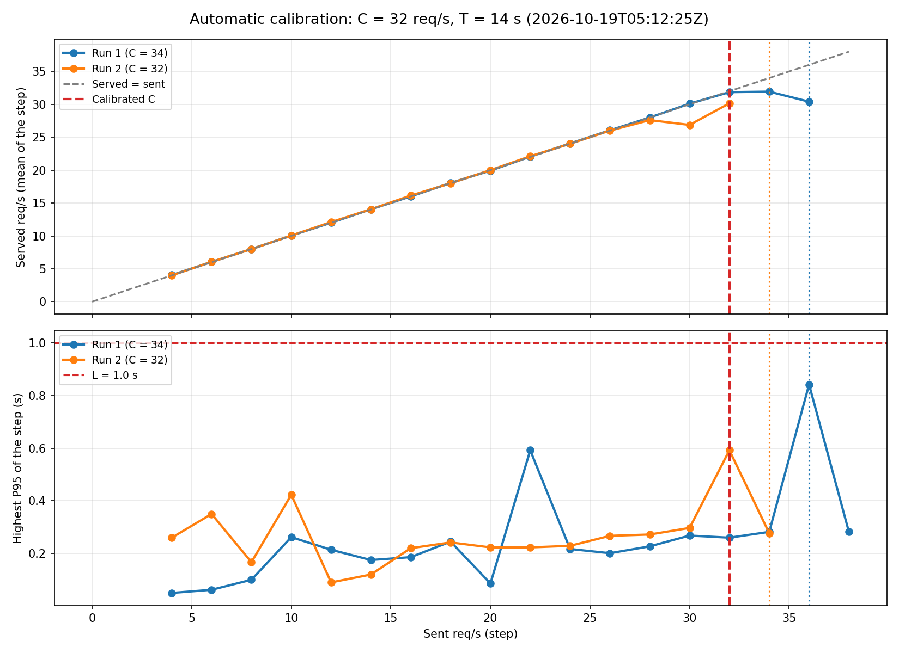

# 14 — Automatic calibration of C and T (`app/aegis/calibrate.py`)

**Date:** 2026-10-19
**Time:** 04:53:07 – 05:12:26 UTC
**Goal:** measure $C$ and $T$ with no manual steps, save them in the cluster, and check that Aegis uses them instead of fixed numbers.

## Setup
- `AEGIS_PROMETHEUS_URL=http://localhost:9090 python3 -m aegis.calibrate --output docs/tests/data/calibration-minikube.json`
- `config.yaml`: $L = 1$ s, $T_d = 15$ s, steps from 4 req/s, +2 req/s every 30 s, 2 capacity runs, $C$ = the lowest.
- What the calibrator does:
  1. Pins the HPA to exactly 1 replica (`minReplicas = maxReplicas = 1`).
  2. Creates a k6 Job with constant-rate steps, one connection per request (same traffic as the demo ramp).
  3. Every 5 s reads P95, served req/s, error ratio and Ready replicas. The pod counts as degraded when, for $T_d$ (3 samples in a row), P95 > $L$, or errors > 1%, or it serves less than 90% of the req/s sent. If the pod has no Ready replica, it counts as degraded at once.
  4. $C$ = the last healthy step. It stops the load, waits for the service to recover and repeats.
  5. Measures $T$: raises `minReplicas` to 3 and times each new pod from the request until it is Ready.
  6. Restores the HPA as it was (also on Ctrl+C or errors) and saves everything in the ConfigMap `aegis-calibration`.
- Aegis (`actuator`, `risk`, `decision`, `replay_risk.py`) now reads $C$ and $T$ from that ConfigMap and refuses to start if there is none. It warns if the image, CPU/memory limit or node type changed since the calibration.

## Results

| Moment | Time (UTC) | What happened |
|---|---|---|
| Run 1 starts | 04:53:09 | HPA pinned to 1 replica |
| Run 1 detects degradation | 05:01:35 | At 36 req/s the pod served ~30 req/s (below 90% for 15 s) → **C = 34** |
| Run 2 starts | 05:02:58 | After recovery and a 60 s cooldown |
| Run 2 detects degradation | 05:10:40 | At 34 req/s the pod stopped passing its readiness probe → **C = 32** |
| T measured | 05:12:11 – 05:12:25 | 2 new pods Ready **12.2 s and 13.3 s** after the request → **T = 14 s** |
| Saved | 05:12:26 | ConfigMap `aegis-calibration`: C = 32, T = 14 |

- A test before this one (04:32 – 04:41 UTC, not saved) only watched P95 and errors. It found C = 36 only because the readiness probe failed: P95 never went above $L$. That is why the served-rate check was added.
- Aegis in `--dry-run` right after: `Calibration from 2026-10-19T05:12:25Z (0.0 h ago): C=32 req/s, T=14 s`.

**Conclusion:** the calibration works with no manual steps (~19 minutes) and gives values close to the hand measurements with the same traffic (test 12: healthy at ~28 req/s; test 03: T = 13 s). $C = 18$ from test 01 was measured with keep-alive traffic and is no longer used.

## Findings
- **The P95 measured by the service does not see saturation.** The service only times requests it has started to handle. When it is full, requests wait outside (in the TCP queue) and P95 still looks healthy (~0.3 s), while the pod serves fewer req/s than it receives and finally fails its readiness probe. With this traffic, "served < sent" and "no Ready pod" detect the break, not P95. The evaluation (plan, phase 6) should also measure latency from the client (k6), not only from the service.
- **Near the limit the served rate wobbles.** In run 2, the 30 req/s step served 26.9 req/s on average (one sample at 18.2), but it was never 3 bad samples in a row, so it counted as healthy. C = 32 may be slightly optimistic; taking the lowest of several runs, $\sigma$ and the live adjustment of $C$ (plan, phase 2.5) are there to cover this.
- The two runs differ by one step (34 vs 32). That is the normal variation of this environment.

## Notes
- Full result (every step of every run, environment, T measurements): `data/calibration-minikube.json`. Raw Prometheus data of the whole calibration: `data/calibration-minikube-raw.csv` (`export_run.py`).
- Chart: `scripts/plot_calibration.py data/calibration-minikube.json data/calibration-minikube.png`.
- $T$ was measured with the node idle. Under load a pod can take longer (26 s in test 04); measuring $T$ live is the next step (plan, phase 2.2).
