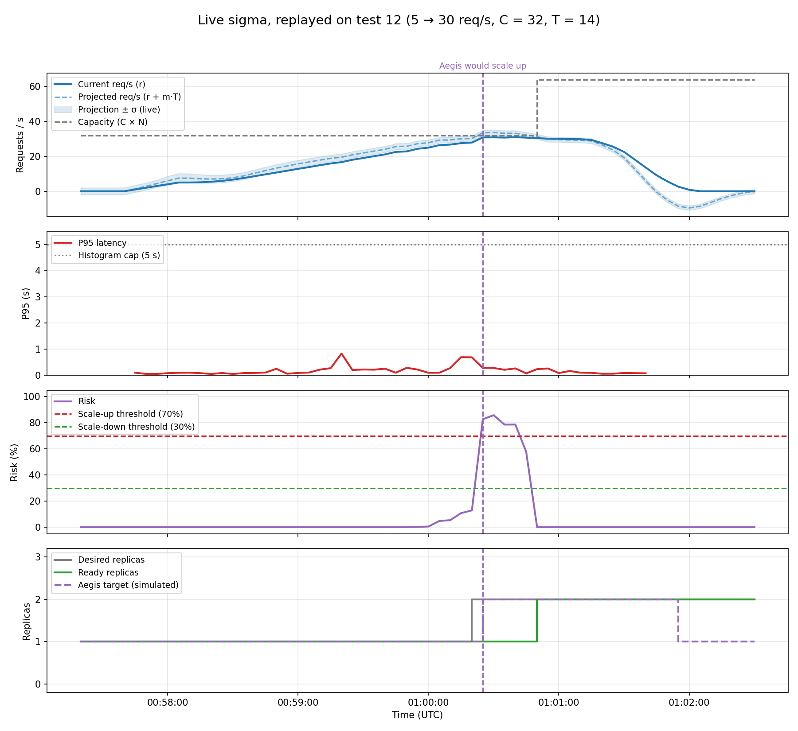

# 15 — Sigma calculated live (`app/aegis/risk.py`, `SigmaEstimator`)

**Date:** 2026-10-19, ~05:20 – 05:55 UTC (no new traffic)
**Goal:** stop using a fixed $\sigma = 2$ and check that the live $\sigma$ behaves well, first with made-up traffic and then replayed on three real runs.

## How sigma is calculated now
- Every 5 s Aegis makes a projection: "in $T$ seconds there will be X req/s". It keeps it until that moment arrives and compares it with the real traffic.
- Only errors where the real traffic was **higher** than projected count. The risk is about going over capacity, so traffic lower than projected is a safe error.
- $\sigma = \sqrt{2 \cdot \text{mean}(\max(0, \text{error})^2)}$ over the last 5 minutes. The factor 2 makes it equal to the usual $\sigma$ when the noise is symmetric. A projection that is always late during a ramp counts fully, because that is the error the risk has to allow for.
- Limits (`config.yaml`, section `sigma`): $\sigma = 2$ until there are 6 errors (~30 s); never below 1 req/s, so very steady traffic does not make Aegis overconfident. A projection whose moment falls inside a data gap is dropped instead of being compared with a late sample.
- The log line of Aegis now shows `sigma=`, and `replay_risk.py` saves it as a column (`--sigma 2` replays with the old fixed value).

## Results with made-up traffic
C = 32, T = 14, one sample every 5 s.

| Scenario | Expected | Obtained |
|---|---|---|
| A. Flat 10 req/s, ±0.2 noise | $\sigma$ goes to the floor | 2.0 for the first 30 s, then **1.0** |
| B. Flat 20 req/s, ±3 noise | $\sigma$ follows the noise | 8.0 at first, **3.1** after 5 min (the noisy slope adds error) |
| C. Ramp 5 → 30 in 2 min | Small $\sigma$, risk above 70% near the peak | $\sigma$ 1.5–2.5; risk 72% at 30 req/s |
| D. 60 s without data | No bogus errors from the gap | Same 17 errors before and after the gap, $\sigma$ stays 1.0 |
| E. Traffic drops from 25 to 0 at once | $\sigma$ does not grow | Stays **1.0** |
| F. Traffic stops, new ramp 1 min later | Aegis reacts to the new ramp as usual | $\sigma$ 2.3–2.6; risk 75% at 30 req/s |

## Results replayed on real runs
Prometheus data of tests 11, 12 and 14 passed through the calculator and the decision engine with the calibration of test 14 (C = 32, T = 14). The decisions are simulated; the replicas are the ones that really happened.

| Run | Live $\sigma$ | Scale-up with live $\sigma$ | Scale-up with fixed $\sigma = 2$ |
|---|---|---|---|
| Test 12 (ramp 5 → 30, one connection per request) | 1.2 – 2.7 | 01:00:25 at 30.8 req/s (risk 82.7%) | Same moment (risk 77.0%) |
| Test 11 (ramp 5 → 30, keep-alive) | 1.0 – 2.7 | 00:39:55 at 31.4 req/s (risk 91.9%) | Same moment (risk 86.0%) |
| Test 14, run 1 (steps up to 36 req/s, broke at 36) | 1.0 – 2.2 | 05:00:40 at 31.8 req/s (risk 76.5%) | **Never**: the highest risk was 69.9% |

In both ramps the scale-down is the same with live or fixed $\sigma$ (60 s after the risk with one replica less went low).

**Conclusion:** the live $\sigma$ stays between 1 and 3 req/s with this traffic, close to the old hand-picked 2 but measured. In ramps Aegis decides at the same moment as before. With traffic in flat steps (test 14) it is a bit more confident ($\sigma = 1$) and would have asked for the second pod at ~32 req/s, before the pod broke at 36; with $\sigma = 2$ it would not have asked at all.

## Design change found by this test
The first version used all errors (above and below). When traffic stopped suddenly, the projection went far below 0 and $\sigma$ jumped to **8–9 req/s** (scenario E) and stayed high for 5 minutes. With such a $\sigma$ a new ramp in those minutes would cross 70% several req/s later. Counting only the errors where traffic came in above the projection fixed it: $\sigma$ stays at 1.0 when traffic stops.

## Notes
- Data and chart: `data/sigma-replay.csv` / `.png` (`replay_risk.py 2026-10-14T00:57:20Z 2026-10-14T01:02:30Z` + `plot_risk.py`). The shaded band in the top panel is projection ± live $\sigma$.
- In all three runs the scale-up only happens near 31–32 req/s, because C = 32 and the demo ramp peaks at 30. To see Aegis prevent a real break, the demo ramp needs a peak above C (plan, phase 2.6).
