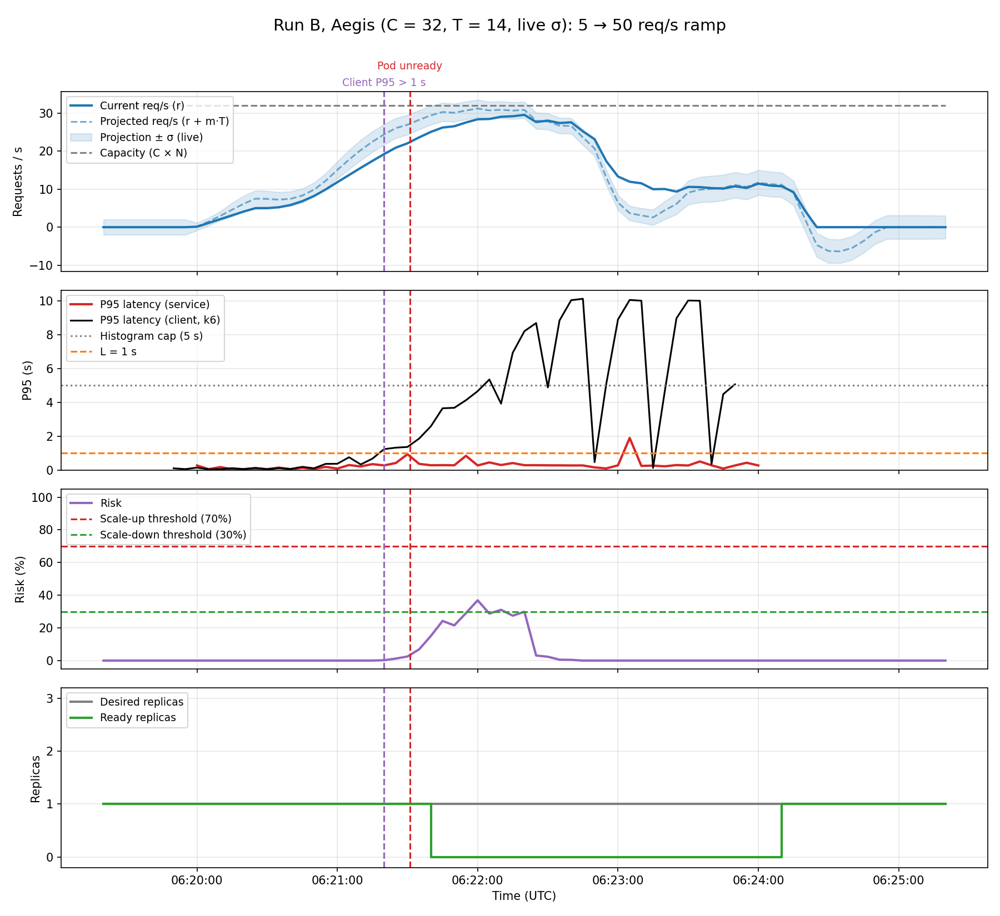
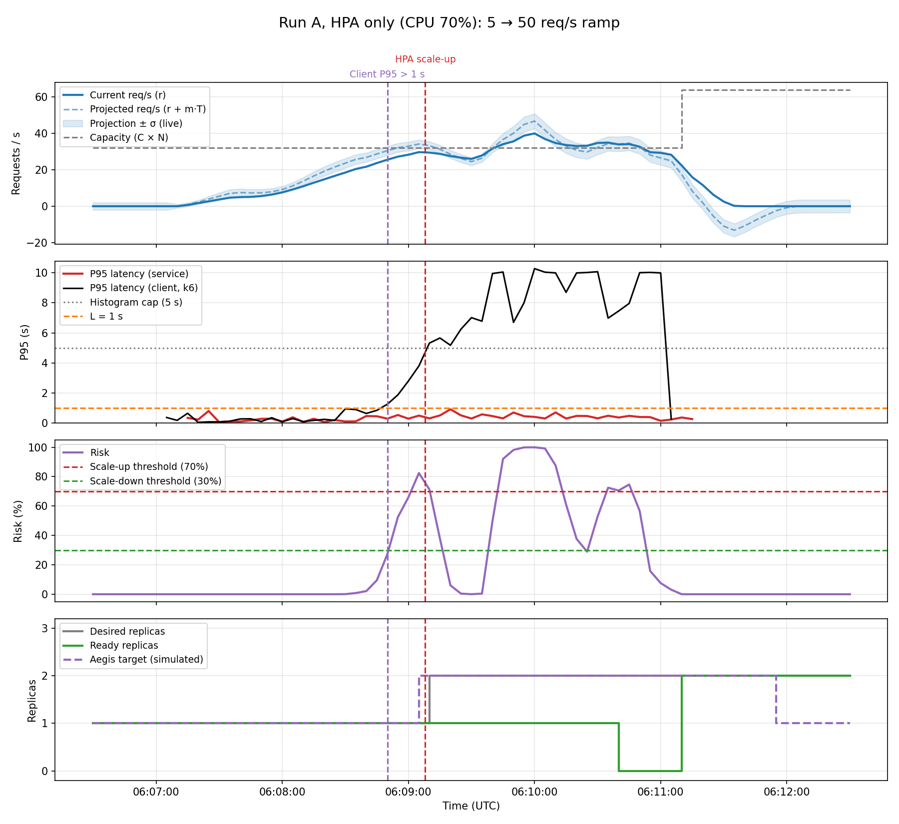

# 16 — HPA vs Aegis with automatic C, T and σ (first attempt)

**Date:** 2026-10-19
**Times:** run A 06:06:56 – 06:11:12 UTC, run B 06:19:32 – 06:24:01 UTC
**Goal:** compare HPA only against Aegis with nothing set by hand (C = 32 and T = 14 from test 14, live σ from test 15), with a ramp that does overload one pod.

## Setup
- New demo ramp (`kubernetes/k6-ramp-demo/`): 30 s at 5 req/s, 2 min from 5 to **50**, 1 min at 50, 30 s down. One connection per request, 10 s client timeout. The old peak (30) was below C = 32.
- Latency is now also measured **by k6** (client side): every request goes to `/results/requests.csv.gz` in the k6 pod and `scripts/fetch_k6_results.py` turns it into P95 every 5 s. The service's own P95 does not see requests waiting outside a saturated pod (test 14).
- Degraded time = client P95 above L = 1 s for at least T_d = 15 s.
- Run A: `scripts/setup.sh --hpa baseline` (CPU 70%), Aegis off.
- Run B: `scripts/setup.sh --hpa aegis` (CPU 95%), Aegis running from the local machine (`python3 -m aegis.actuator`).

## Results

| | Run A, HPA only | Run B, Aegis |
|---|---|---|
| Second pod requested | 06:09:08 (CPU above target) | **never** |
| Highest risk calculated by Aegis | (replayed: 82.5% at 06:09:05) | **37%** |
| Client P95 above 1 s from | 06:08:50 | 06:21:20 |
| Seconds degraded (client) | 135 s | 130 s |
| Requests / failed | 6770 / **16.3%** | 6436 / **38.8%** |
| k6 P95 / max | 10.0 s / 10.6 s (timeout) | 10.0 s / 10.2 s (timeout) |
| Dropped iterations | 504 | 838 |
| Time with 0 Ready pods | short | **06:21:40 – 06:24:10** (whole peak) |

**Conclusion:** with an accurate C, Aegis did worse than the plain HPA. It never asked for the second pod, the only pod failed its readiness probe, and the Service had no endpoint for the whole peak.

## Why Aegis never scaled up

**1. Aegis measures the traffic the pod serves, not the traffic that arrives.** The req/s Aegis reads come from the service's own counter: requests it has finished. A pod cannot finish more than its capacity, so that number stops near C (here at **29.6 req/s**, while k6 was sending 50). The projection stops too, and the risk never goes above ~37%.

Before test 14 this was hidden: with C = 18 (too low), the served traffic passed C long before the pod saturated. With the real C, the input of Aegis saturates exactly where it should warn.

**2. The pod breaks earlier with a fast ramp than in the calibration.** The calibration climbs +2 req/s every 30 s and the pod held 32–34 req/s. The demo ramp climbs ~0.4 req/s every second; the client P95 passed 1 s at ~30 req/s sent (run A) and the pod failed its readiness probe with ~28 req/s served (run B).

**3. A saturated pod is taken out of the Service.** The readiness probe (`/health`, 1 s timeout) shares the CPU with the requests. When the pod is full it does not answer in time, Kubernetes marks it not Ready, and with only one pod the Service has nowhere to send traffic: every request fails until the pod recovers. That is why run B has 38.8% failed requests, more than run A, where the HPA had added a second pod.

## Notes
- Replaying run A through Aegis (C = 32) gives a scale-up at 06:09:05, 15 s after the client P95 broke and 3 s before the HPA: in run A the served traffic did reach ~30 before the pod was overwhelmed.
- In a replay of runs A, test 12 and calibration run 1, a shorter rate window (10 s instead of 30 s) moved the scale-up 15–35 s earlier. It helps, but does not fix point 1.
- Data: `data/final-hpa*.csv/png`, `data/final-aegis*.csv/png`, k6 summaries in `data/final-*-client-summary.json`. Charts with `replay_risk.py` + `plot_risk.py --client`; traffic per pod with `plot_pods.py`.
