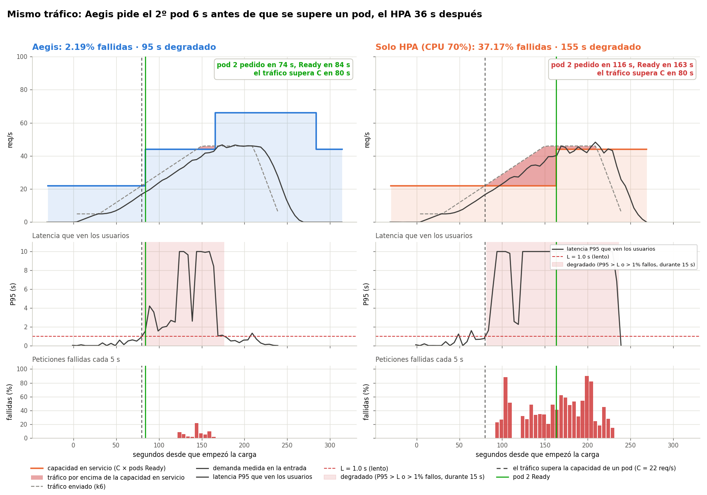
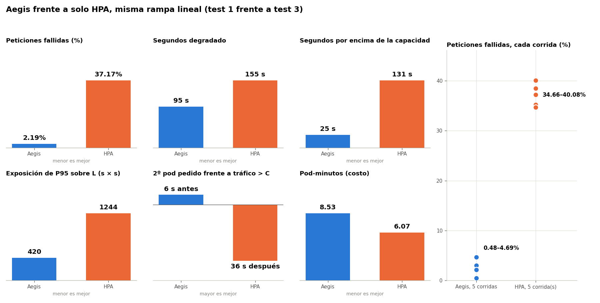

# Pruebas

32 corridas en minikube, 2026-10-25. Calibración (`calibration.json`, pod de 60m de CPU): **C = 22 req/s**, **T = 15 s**. Degradado = P95 del cliente > 1 s o > 1% de fallos, durante 15 s. Las cargas están escritas para C = 24 y se escalan por C / 24.

| Prueba | Tráfico | Modo | Corridas | Fallidas (media, mín–máx) |
|---|---|---|---|---|
| [1](test1-linear-ramp/README.es.md) | Rampa 5 → 46 req/s en 2 min | Aegis | 5 | **2.5%** (0.48–4.69) |
| [3](test3-hpa-baseline/README.es.md) | La misma rampa | Solo HPA (CPU 70%) | 5 | **37.1%** (34.7–40.1) |
| [4](test4-spike-aegis/) | Pico 5 → 41 req/s en 5 s | Aegis | 5 | **13.3%** (11.7–16.1) |
| [5](test5-spike-hpa/) | El mismo pico | Solo HPA | 5 | **54.8%** (51.9–61.0) |
| [2](test2-fluctuating/README.es.md) | Olas a 28 y 46 req/s | Aegis | 3 | 0.64% (0.32–0.97) |
| [6](test6-ramp-045/) | Rampa a 0.41 req/s por s | Aegis | 3 | 1.06% (0.34–1.82) |
| [7](test7-ramp-050/) | Rampa a 0.46 req/s por s | Aegis | 3 | 1.73% (0.94–2.78) |
| [8](test8-metric-mode/) | La rampa de la prueba 1 | Aegis por la Custom Metrics API | 3 | 20.2% (18.4–21.3) |

Detalle: [comparison.md](comparison.md), [forecast.md](forecast.md), [capacity.md](../capacity.md), [limitations.md](../limitations.md).

## Aegis contra el HPA, la misma rampa



Corridas medianas: prueba 1 corrida 4 y prueba 3 corrida 1. El rojo es tráfico por encima de la capacidad de los pods Ready.



| 5 corridas cada una | Aegis | Solo HPA |
|---|---|---|
| Pide el 2º pod | 73.5–74.5 s (**6 s antes** de C) | 116–145 s (**36–65 s después**) |
| Fallidas | **2.5%** | **37.1%** |
| Segundos degradado | 100 | 162 |
| Pods-minuto | 8.53 | 5.74 |

Compara los momentos en que se pide el pod, no los de Ready: Traefik manda tráfico a pods no listos, así que un pod que arranca en sobrecarga atiende antes de estar Ready ([limitations.md](../limitations.md#pod-startup-under-overload)).

## Correr

```bash
cd scripts/experiments
python3 preflight.py       # qué falta y cuánto tarda
./run_all.sh               # todas las pruebas (~3 h, se puede retomar), luego gráficas, comparación, capacidad y pronóstico
python3 run.py test1-linear-ramp --runs 5
python3 report.py && python3 compare.py && python3 forecast_accuracy.py
```

Cada corrida empieza con 1 pod Ready, un HPA nuevo y sin tráfico. Las corridas de otra calibración van a `archive/` (`--archive`); las inválidas del 2026-10-25 están en `archive/invalid-2026-10-25/`.
