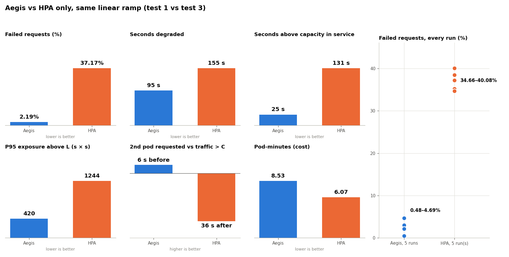

# Tests

32 runs on minikube, 2026-10-25. Calibration (`calibration.json`, pod 60m CPU): **C = 22 req/s**, **T = 15 s**. Degraded = client P95 > 1 s or > 1% failed, for 15 s. Load files are written for C = 24 and scaled by C / 24.

| Test | Traffic | Mode | Runs | Failed (mean, min–max) |
|---|---|---|---|---|
| [1](test1-linear-ramp/) | Ramp 5 → 46 req/s in 2 min | Aegis | 5 | **2.5%** (0.48–4.69) |
| [3](test3-hpa-baseline/) | Same ramp | HPA only (CPU 70%) | 5 | **37.1%** (34.7–40.1) |
| [4](test4-spike-aegis/) | Spike 5 → 41 req/s in 5 s | Aegis | 5 | **13.3%** (11.7–16.1) |
| [5](test5-spike-hpa/) | Same spike | HPA only | 5 | **54.8%** (51.9–61.0) |
| [2](test2-fluctuating/) | Waves to 28 and 46 req/s | Aegis | 3 | 0.64% (0.32–0.97) |
| [6](test6-ramp-045/) | Ramp at 0.41 req/s per s | Aegis | 3 | 1.06% (0.34–1.82) |
| [7](test7-ramp-050/) | Ramp at 0.46 req/s per s | Aegis | 3 | 1.73% (0.94–2.78) |
| [8](test8-metric-mode/) | Ramp of test 1 | Aegis via Custom Metrics API | 3 | 20.2% (18.4–21.3) |

Details: [comparison.md](comparison.md), [forecast.md](forecast.md), [capacity.md](../capacity.md), [limitations.md](../limitations.md).

## Aegis vs HPA, same ramp


Median runs: test 1 run 4 and test 3 run 1. Red is traffic above the capacity of the Ready pods.



| 5 runs each | Aegis | HPA only |
|---|---|---|
| 2nd pod requested | 73.5–74.5 s (**6 s before** C) | 116–145 s (**36–65 s after**) |
| Failed | **2.5%** | **37.1%** |
| Seconds degraded | 100 | 162 |
| Pod-minutes | 8.53 | 5.74 |

Compare request times, not Ready times: Traefik routes to not-ready pods, so a pod started during overload serves before it is Ready ([limitations.md](../limitations.md#pod-startup-under-overload)).

## Run

```bash
cd scripts/experiments
python3 preflight.py       # what is missing and how long it takes
./run_all.sh               # all tests (~3 h, resumable), then charts, comparison, capacity, forecast
python3 run.py test1-linear-ramp --runs 5
python3 report.py && python3 compare.py && python3 forecast_accuracy.py
```

Every run starts from 1 Ready pod, a new HPA and no traffic. Runs with another calibration go to `archive/` (`--archive`); invalid runs of 2026-10-25 are in `archive/invalid-2026-10-25/`.
