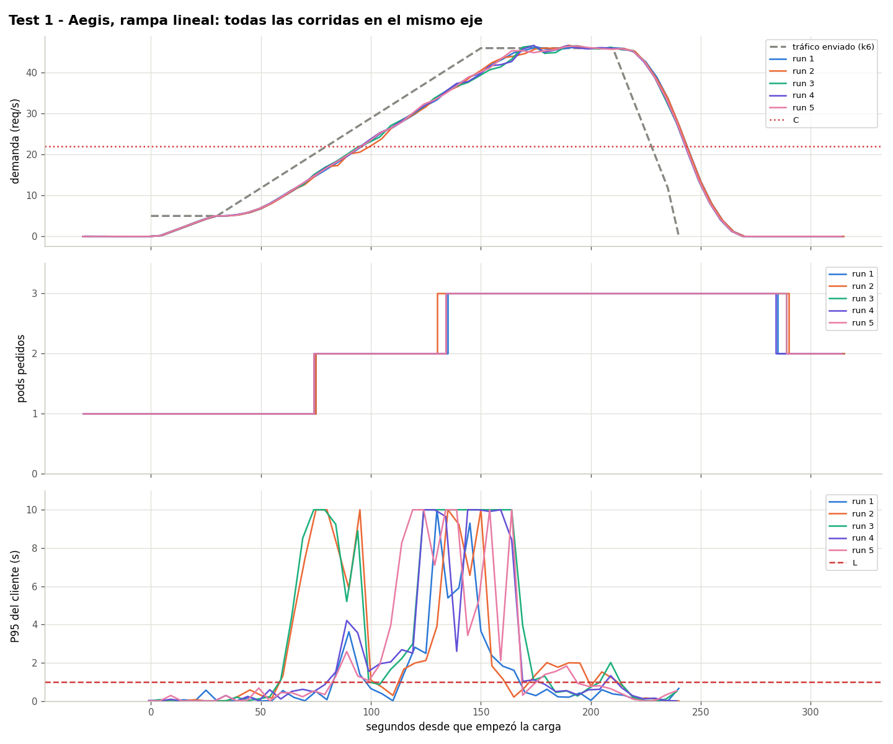
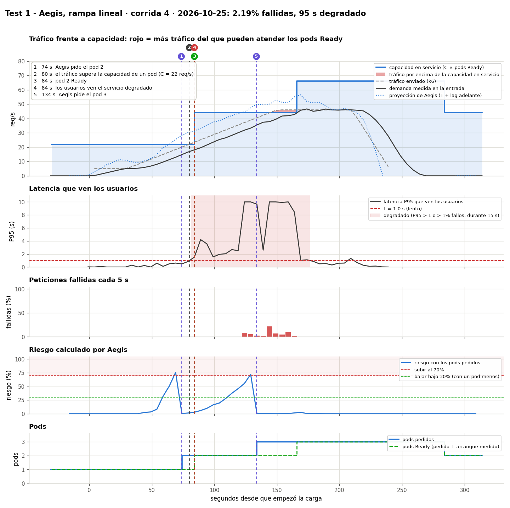

# Prueba 1: Aegis con una rampa lineal

**Fecha:** 2026-10-25, 03:24 – 03:55 UTC, 5 corridas
**Objetivo:** mostrar que Aegis predice el tráfico y pide un pod antes de que uno ya no alcance.

## Qué se hizo
- Tráfico (`kubernetes/load/linear.yaml`, escalado ×0.917 a C = 22): 30 s a 5 req/s, 2 min de 5 a 46 req/s, 1 min a 46, 30 s de bajada.
- Aegis corriendo en esta máquina (`python3 -m aegis.actuator`, modo `min_replicas`) con el HPA de `kubernetes/hpa/aegis.yaml`.
- Calibración: C = 22 req/s por pod, T = 15 s. El tráfico pasa C en el segundo 80 y 2C (44) en el 145.

## Resultados

| Segundo (desde que empezó k6), corrida 4 | Qué pasó |
|---|---|
| 73.6 | Aegis pide el 2º pod: riesgo con 1 pod 75.6% |
| 80 | El tráfico pasa lo que aguanta un pod (C = 22) |
| 84 | El 2º pod está Ready |
| 133.6 | Aegis pide el 3er pod (riesgo con 2 pods 72.1%) |
| 166 | El 3er pod está Ready (33 s: arrancó con los 2 pods saturados) |
| 240 | Termina la carga |
| 283.6 | Aegis vuelve a 2 pods, 60 s después de que bajó el riesgo |

| Corrida | Pide 2º pod (s) | 2º pod Ready (s) | Pide 3er pod (s) | Fallidas | Segundos degradado | Pods-minuto |
|---|---|---|---|---|---|---|
| 1 | 74.5 | 85 | 134.5 | 0.48% | 70 | 8.50 |
| 2 | 74.3 | 84 | 129.3 | 2.99% | 120 | 8.58 |
| 3 | 73.5 | 83 | 133.5 | 4.69% | 115 | 8.53 |
| 4 | 73.6 | 84 | 133.6 | 2.19% | 95 | 8.53 |
| 5 | 73.7 | 84 | 133.7 | 2.17% | 100 | 8.53 |

Las decisiones se repiten con ±1 s. Los fallos varían más: en las corridas 2 y 3 el único pod se degradó a ~17 req/s (bajo C), y la mayoría de fallos llegan cerca del pico de 46 req/s, solo 5% sobre 2C.

## Conclusión
El 2º pod se pidió antes de C en las 5 corridas: 2.5% de fallos, contra 37.1% con solo el HPA ([prueba 3](../test3-hpa-baseline/README.es.md)).

Datos: `data/` (archivos por corrida) y `results.csv`.
