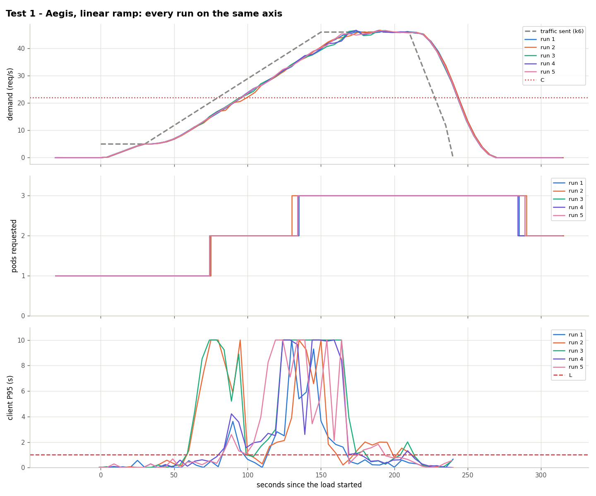
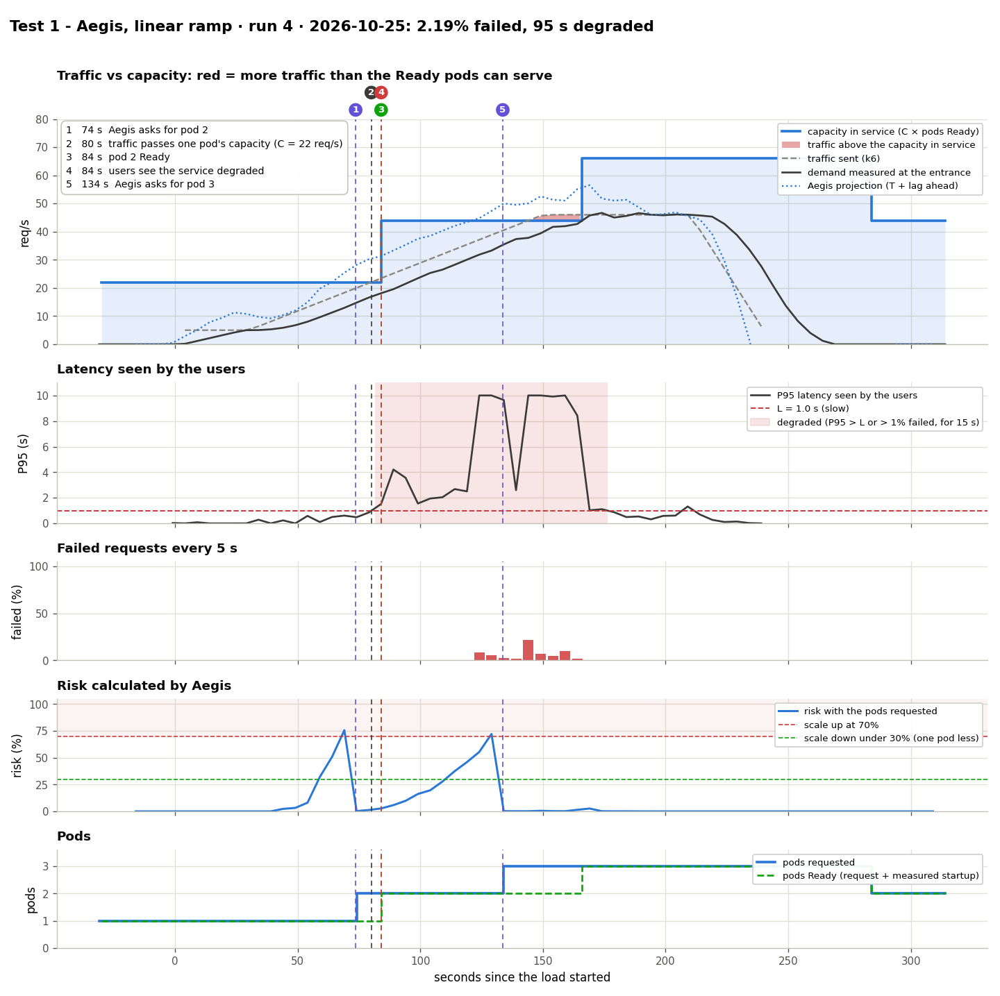

# Test 1: Aegis with a linear ramp

**Date:** 2026-10-25, 03:24 – 03:55 UTC, 5 runs
**Goal:** show that Aegis predicts the traffic and asks for a pod before one pod is no longer enough.

## What was done
- Traffic (`kubernetes/load/linear.yaml`, scaled ×0.917 to C = 22): 30 s at 5 req/s, 2 min from 5 to 46 req/s, 1 min at 46, 30 s down.
- Aegis running on this machine (`python3 -m aegis.actuator`, `min_replicas` mode) with the HPA of `kubernetes/hpa/aegis.yaml`.
- Calibration: C = 22 req/s per pod, T = 15 s. The traffic passes C at second 80 and 2C (44) at second 145.

## Results

| Second (since k6 started), run 4 | What happened |
|---|---|
| 73.6 | Aegis asks for the 2nd pod: risk with 1 pod 75.6% |
| 80 | The traffic passes what one pod can serve (C = 22) |
| 84 | The 2nd pod is Ready |
| 133.6 | Aegis asks for the 3rd pod (risk with 2 pods 72.1%) |
| 166 | The 3rd pod is Ready (33 s: it started while the 2 pods were saturated) |
| 240 | The load ends |
| 283.6 | Aegis goes back to 2 pods, 60 s after the risk dropped |

| Run | 2nd pod asked (s) | 2nd pod Ready (s) | 3rd pod asked (s) | Failed | Seconds degraded | Pod-minutes |
|---|---|---|---|---|---|---|
| 1 | 74.5 | 85 | 134.5 | 0.48% | 70 | 8.50 |
| 2 | 74.3 | 84 | 129.3 | 2.99% | 120 | 8.58 |
| 3 | 73.5 | 83 | 133.5 | 4.69% | 115 | 8.53 |
| 4 | 73.6 | 84 | 133.6 | 2.19% | 95 | 8.53 |
| 5 | 73.7 | 84 | 133.7 | 2.17% | 100 | 8.53 |

Decisions repeat within ±1 s. Failures vary more: in runs 2 and 3 the single pod degraded at ~17 req/s (below C), and most failures come near the 46 req/s peak, only 5% above 2C.

## Conclusion
The 2nd pod was requested before C in all 5 runs: 2.5% failed, against 37.1% with the HPA alone ([test 3](../test3-hpa-baseline/)).

Data: `data/` (files per run) and `results.csv`.
