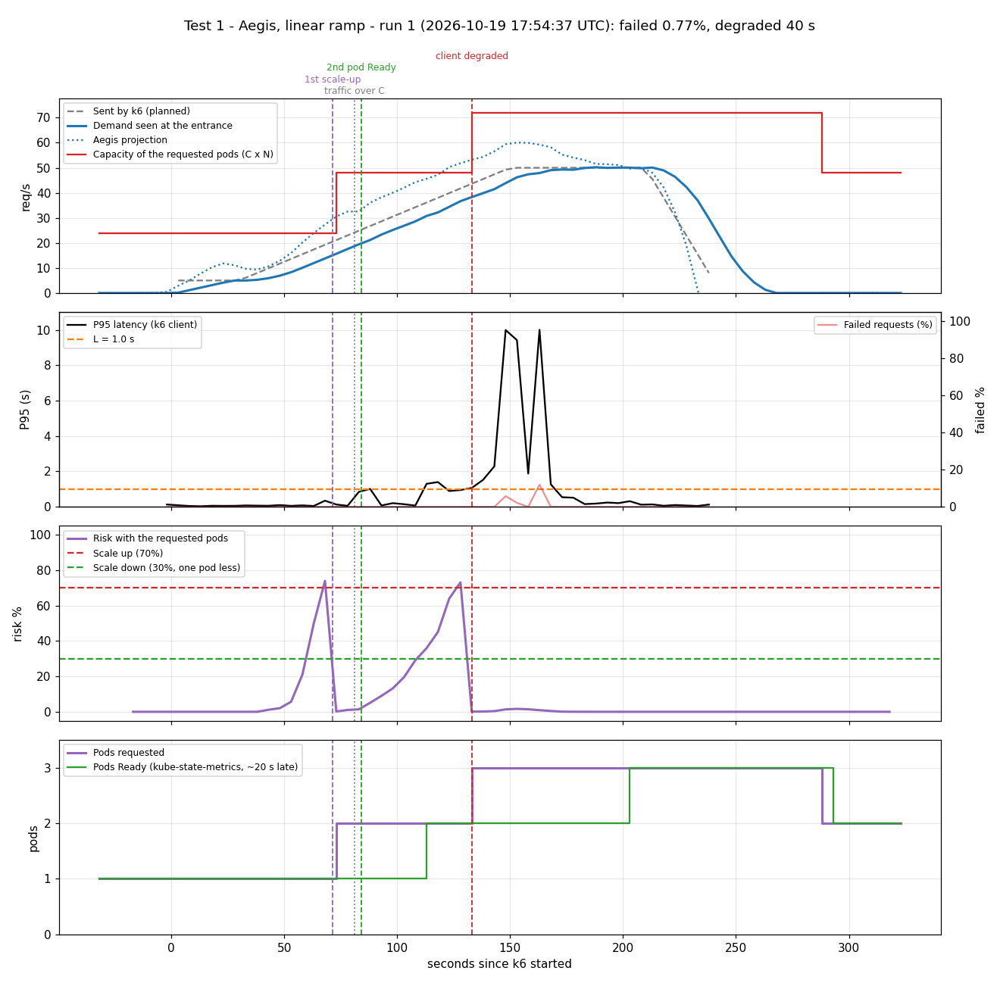

# Test 1: Aegis with a linear ramp

**Date:** 2026-10-19, 17:54:37 – 18:00:00 UTC
**Goal:** show that Aegis predicts the traffic and asks for a pod before one pod is no longer enough.

## What was done
- Traffic (`kubernetes/load/linear.yaml`): 30 s at 5 req/s, 2 min from 5 to 50 req/s, 1 min at 50, 30 s down.
- Aegis running (`python3 -m aegis.actuator`) with the HPA of `kubernetes/hpa/aegis.yaml`.
- Calibration of this machine: C = 24 req/s per pod, T = 15 s. The traffic passes C at second 81 and 2C (48) at second 145.
- Latency measured by k6, from the client side.

## Results

| Second (since k6 started) | What happened |
|---|---|
| 71 | Aegis asks for the 2nd pod: demand 15.7 req/s, projection 27.3, risk 73.9% |
| 81 | The traffic passes what one pod can serve (C = 24) |
| 84 | The 2nd pod is Ready |
| 131 | Aegis asks for the 3rd pod (projection 51.8 > 2C) |
| 240 | The load ends |
| 286 | Aegis goes back to 2 pods, 60 s after the risk dropped |

k6: 7266 requests, **0.77% failed**, P95 1.38 s. 40 s with P95 above 1 s, while the 3rd pod was starting (the node has only 2 CPUs and a starting pod takes CPU from the others).

## Conclusion
Aegis asked for the 2nd pod **10 s before** the traffic went over one pod, so it was serving right when it was needed. With the plain HPA the same ramp had 30.65% failed requests ([test 3](../test3-hpa-baseline/)).

## Not luck
The same test was repeated 4 more times (`data/repeat-runs-summary.json`):

| Run | 2nd pod asked (s) | 2nd pod Ready (s) | Failed | Pods |
|---|---|---|---|---|
| 1 (chart) | 71 | 84 | 0.77% | 1 → 2 → 3 → 2 |
| 2 | 71 | 84 | 0.95% | 1 → 2 → 3 → 2 |
| 3 | 71 | 84 | 0.48% | 1 → 2 → 3 → 2 |
| 4 | 75 | 87 | 0.84% | 1 → 2 → 3 → 2 |
| 5 | 70 | 82 | 0.24% | 1 → 2 → 3 → 2 |

Data: `data/run-1.csv` (every 5 s), `data/run-1-aegis.ndjson` (every Aegis cycle), `data/run-1-k6.log`, `data/run-1-summary.json`.
