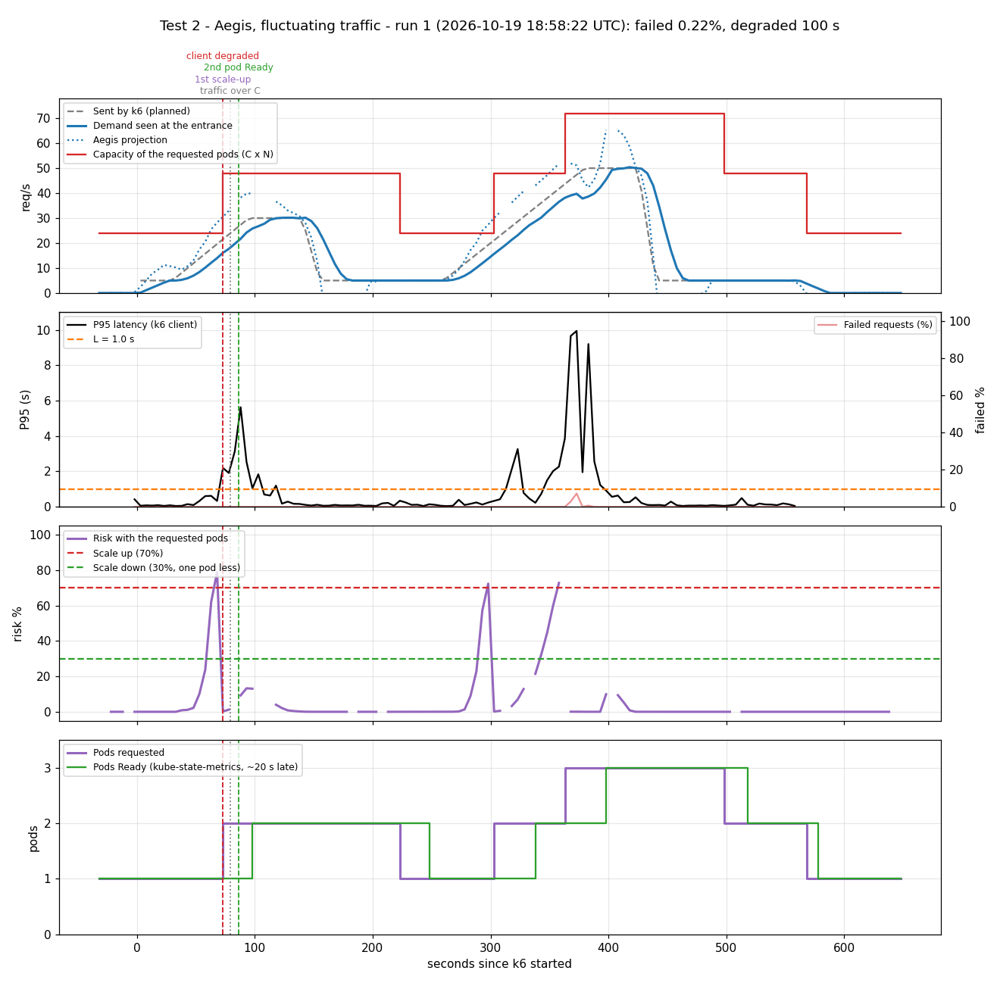

# Prueba 2: Aegis con tráfico fluctuante

**Fecha:** 2026-10-19, 18:58:22 – 19:09:10 UTC
**Objetivo:** mostrar que Aegis sube en cada ola y **devuelve los pods** cuando el tráfico baja.

## Qué se hizo
- Tráfico (`kubernetes/load/fluctuating.yaml`, 560 s): 30 s a 5 req/s, una ola hasta 30 req/s (65 s subiendo, 45 s plano), 105 s en 5, una ola hasta 50 req/s (120 s subiendo, 45 s plano), 120 s en 5. Las dos olas suben tan rápido como la rampa de la prueba 1.
- Aegis corriendo con el HPA de `kubernetes/hpa/aegis.yaml`.
- Calibración: C = 24 req/s por pod, T = 15 s. El tráfico pasa C en el segundo 79 (ola 1) y 311 (ola 2), y 2C (48) en el segundo 375.

## Resultados

| Segundo (desde que arrancó k6) | Qué pasó |
|---|---|
| 73 | Aegis pide el 2º pod (demanda 16.1, proyección 28.2, riesgo 78.9%) |
| 79 | El tráfico pasa C |
| 86 | El 2º pod está Ready |
| 140–155 | El tráfico baja a 5 req/s |
| 223 | **Baja 2 → 1**: 60 s con riesgo bajo 30% con un pod menos |
| 303 | Segunda ola: Aegis pide el 2º pod (riesgo 72.4%), antes de que el tráfico pase C en el 311 |
| 363 | Aegis pide el 3er pod (proyección 51.8 > 2C), antes de que el tráfico pase 2C en el 375 |
| 425–440 | El tráfico baja a 5 req/s |
| 498 | **Baja 3 → 2** |
| 568 | **Baja 2 → 1** |

k6: 9817 peticiones, **0.22% fallidas**, P95 1.89 s. 100 s con el P95 sobre 1 s, en picos cortos mientras arrancaba un pod nuevo (el nodo tiene solo 2 CPUs). Pods: 1 → 2 → 1 → 2 → 3 → 2 → 1, 18.4 pods-minuto.

## Conclusión
En las dos olas Aegis pidió el pod antes de que el tráfico pasara lo que aguantan los pods que ya había, y después de cada ola volvió a 1 pod, de a un paso, sin subir y bajar en el medio.

## Límite: olas más bruscas
Una primera versión de esta prueba tenía olas casi el doble de empinadas (a 40 req/s en 60 s y a 55 req/s en 45 s). Ahí Aegis pidió el pod en el mismo momento en que el tráfico pasaba C, no antes, y **fallaron 12.59% de las peticiones** (`data/steep-waves-summary.json`, `data/steep-waves-chart.png`). Entre pedir un pod y tenerlo Ready, Aegis necesita unos T + 20 ≈ 35 s de tendencia visible. Una subida más rápida no se puede anticipar con ese margen. Es la hipótesis H2 de `docs/experiments/methodology.md` y se va a medir contra el HPA en la evaluación formal.

Datos: `data/run-1.csv` (cada 5 s), `data/run-1-aegis.ndjson` (cada ciclo de Aegis), `data/run-1-k6.log`, `data/run-1-summary.json`.
