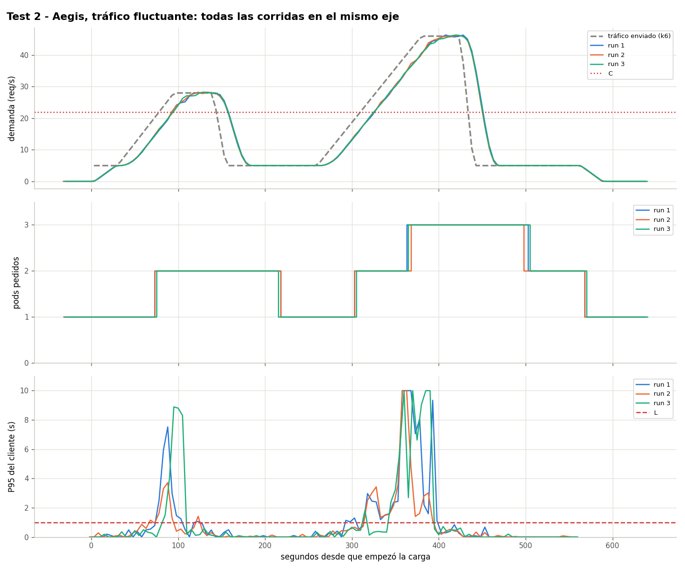
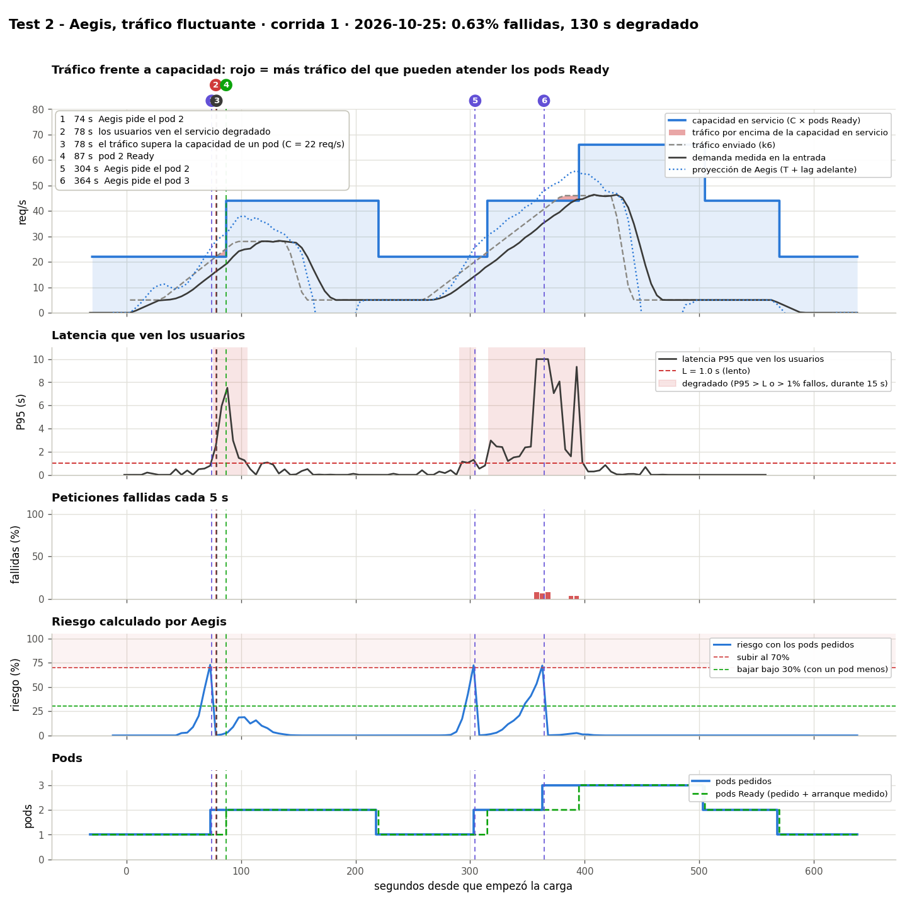

# Prueba 2: Aegis con tráfico fluctuante

**Fecha:** 2026-10-25, corridas a las 05:06, 15:38 y 15:49 UTC
**Objetivo:** mostrar que Aegis sube en cada ola y **devuelve los pods** cuando el tráfico baja.

## Qué se hizo
- Tráfico (`kubernetes/load/fluctuating.yaml`, 560 s, ×0.917): 30 s a 5 req/s, una ola a 28 req/s (65 s de subida, 45 s plana), 105 s a 5, una ola a 46 req/s (120 s de subida, 45 s plana), 120 s a 5.
- Aegis corriendo con el HPA de `kubernetes/hpa/aegis.yaml`.
- Calibración: C = 22 req/s por pod, T = 15 s. El tráfico pasa C en el segundo 78.5 (ola 1) y otra vez en la ola 2, y 2C (44) cerca de su pico.

## Resultados

| Corrida | Cambios de pods (s desde que empezó k6) | Fallidas | Segundos degradado | Pods-minuto | Falsas alarmas |
|---|---|---|---|---|---|
| 1 | 1→2 en 74, 2→1 en 219, 1→2 en 304, 2→3 en 364, 3→2 en 504, 2→1 en 569 | 0.63% | 130 | 18.33 | 0 |
| 2 | 1→2 en 74, 2→1 en 219, 1→2 en 304, 2→3 en 369, 3→2 en 499, 2→1 en 569 | 0.32% | 100 | 18.18 | 0 |
| 3 | 1→2 en 74, 2→1 en 214, 1→2 en 304, 2→3 en 364, 3→2 en 504, 2→1 en 569 | 0.97% | 75 | 18.27 | 0 |

## Conclusión
La misma secuencia en todas las corridas (±5 s): sube antes de que cada ola pase C, baja de a un paso 60 s después de que cae el riesgo, sin pods innecesarios. La espera de 60 s cuesta ~4.9 pods-minuto por corrida.

## Límite: olas más empinadas
Con olas el doble de empinadas (0.58 req/s por s, primera evaluación) el pod se pidió en el cruce y **fallaron 12.59%** (`data/steep-waves-*`). Las pruebas 6 y 7 miden el límite ([comparison.md](../comparison.md#boundary-how-fast-the-traffic-can-rise)).

Datos: `data/` (archivos por corrida) y `results.csv`.
