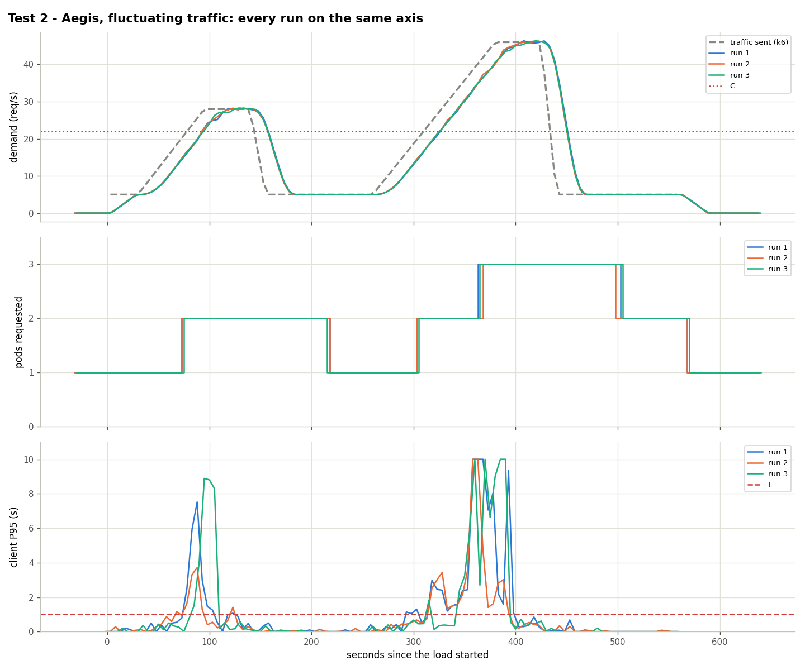
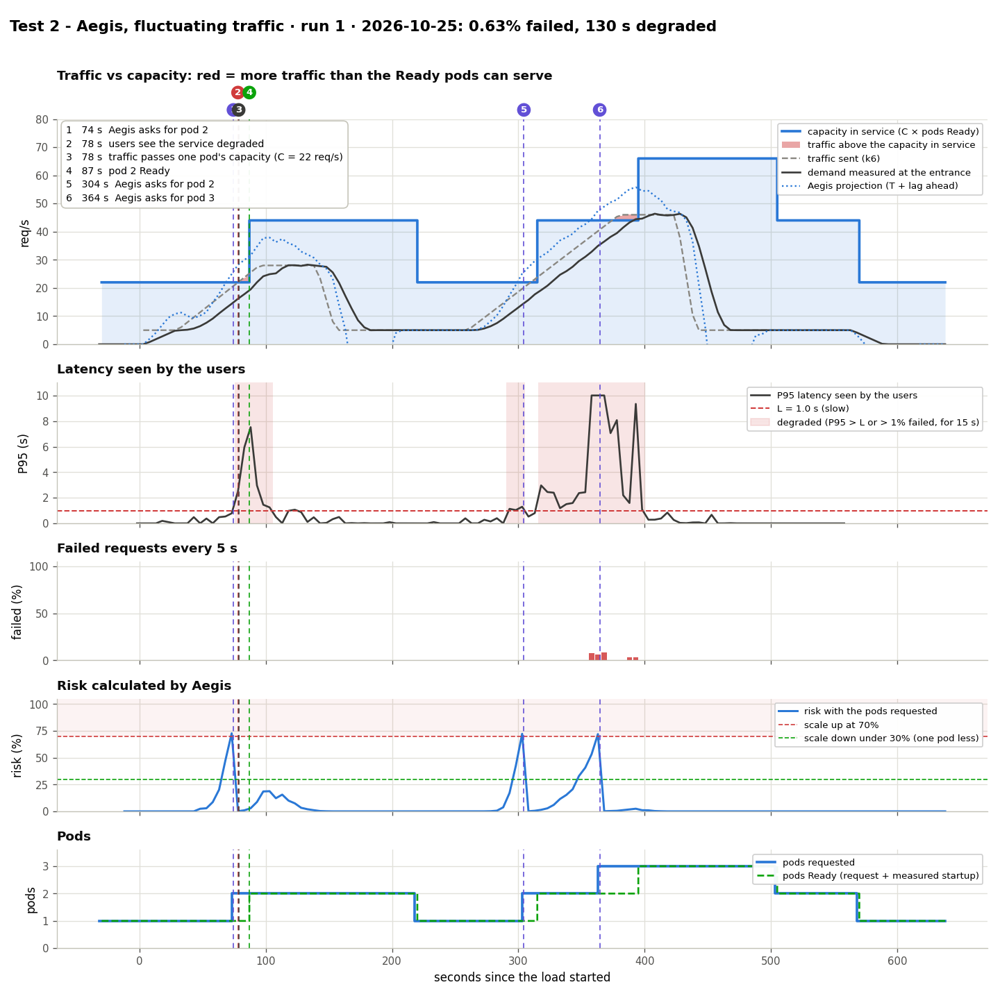

# Test 2: Aegis with fluctuating traffic

**Date:** 2026-10-25, runs at 05:06, 15:38 and 15:49 UTC
**Goal:** show that Aegis scales up on each wave and **gives the pods back** when the traffic drops.

## What was done
- Traffic (`kubernetes/load/fluctuating.yaml`, 560 s, ×0.917): 30 s at 5 req/s, a wave to 28 req/s (65 s up, 45 s flat), 105 s at 5, a wave to 46 req/s (120 s up, 45 s flat), 120 s at 5.
- Aegis running with the HPA of `kubernetes/hpa/aegis.yaml`.
- Calibration: C = 22 req/s per pod, T = 15 s. The traffic passes C at second 78.5 (wave 1) and again on wave 2, and 2C (44) near its peak.

## Results

| Run | Scale changes (s since k6 started) | Failed | Seconds degraded | Pod-minutes | False alarms |
|---|---|---|---|---|---|
| 1 | 1→2 at 74, 2→1 at 219, 1→2 at 304, 2→3 at 364, 3→2 at 504, 2→1 at 569 | 0.63% | 130 | 18.33 | 0 |
| 2 | 1→2 at 74, 2→1 at 219, 1→2 at 304, 2→3 at 369, 3→2 at 499, 2→1 at 569 | 0.32% | 100 | 18.18 | 0 |
| 3 | 1→2 at 74, 2→1 at 214, 1→2 at 304, 2→3 at 364, 3→2 at 504, 2→1 at 569 | 0.97% | 75 | 18.27 | 0 |

## Conclusion
The same sequence in all runs (±5 s): up before each wave passes C, down one step at a time 60 s after the risk drops, no unneeded pod. The 60 s wait costs ~4.9 pod-minutes per run.

## Limit: steeper waves
With waves twice as steep (0.58 req/s per s, first evaluation) the pod was requested at the crossing and **12.59% failed** (`data/steep-waves-*`). Tests 6 and 7 measure the boundary ([comparison.md](../comparison.md#boundary-how-fast-the-traffic-can-rise)).

Data: `data/` (files per run) and `results.csv`.
