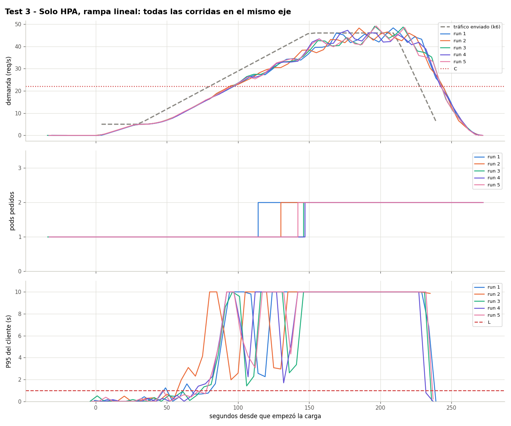
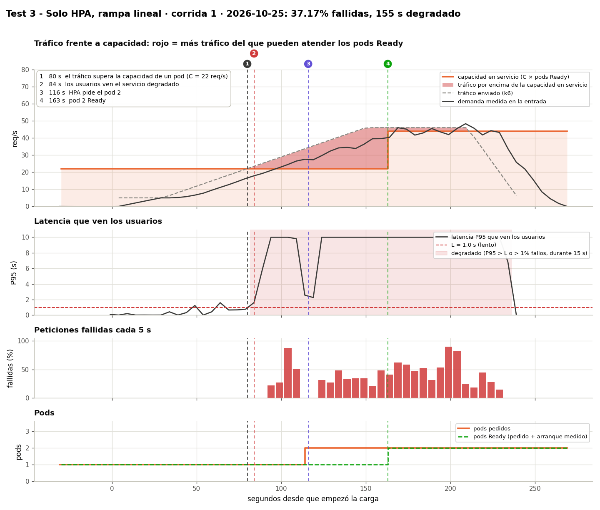

# Prueba 3: el HPA normal, sin Aegis

**Fecha:** 2026-10-25, 14:40 – 15:12 UTC, 5 corridas
**Objetivo:** mostrar qué hace el HPA de siempre con la misma rampa de la [prueba 1](../test1-linear-ramp/README.es.md).

## Qué se hizo
- El mismo tráfico de la prueba 1 (`kubernetes/load/linear.yaml`, ×0.917): de 5 a 46 req/s en 2 min, 1 min a 46.
- Aegis apagado. HPA de `kubernetes/hpa/baseline.yaml`: escala por CPU al 70%, valores por defecto de Kubernetes. Cada corrida empieza con un HPA recién creado y 1 pod sin carga.
- Un pod atiende C = 22 req/s: el tráfico lo pasa en el segundo 80.

## Resultados

| Corrida | Degradado desde (s) | Pide 2º pod (s) | 2º pod Ready (s) | Fallidas | Segundos degradado | Máximo de pods |
|---|---|---|---|---|---|---|
| 1 | 84 | 116 | 163 | 37.17% | 155 | 2 |
| 2 | 60 | 130 | 178 | 40.08% | 180 | 2 |
| 3 | 76 | 144 | 233 | 35.21% | 160 | 2 |
| 4 | 72 | 145 | 224 | 34.66% | 160 | 2 |
| 5 | 82 | 144 | 233 | 38.48% | 155 | 2 |

El HPA pide el 2º pod 36–65 s después de que el tráfico pasó C, cuando el servicio ya lleva 30–70 s degradado. Nunca pide un 3er pod: a 46 req/s los dos pods (2C = 44) siguen sobrecargados hasta que termina la carga. La P95 del cliente es 10 s (el timeout de k6) en todas las corridas.

El pod nuevo queda Ready 47–89 s después de crearse (10–11 s si arranca antes de la sobrecarga), pero atiende antes: Traefik le manda tráfico antes de estar Ready y su probe queda en cola tras esas peticiones ([limitations.md](../../limitations.md#pod-startup-under-overload)). Compara los momentos en que se pide (116–145 s contra 74 s) y los fallos.

## Conclusión
El HPA reacciona cuando la CPU ya está alta, con el servicio ya roto. Aegis pidió el pod 6 s **antes** de C y falló 2.5% en vez de 37.1%, a cambio de 2.8 pods-minuto más por corrida.

Datos: `data/` (archivos por corrida) y `results.csv`.
