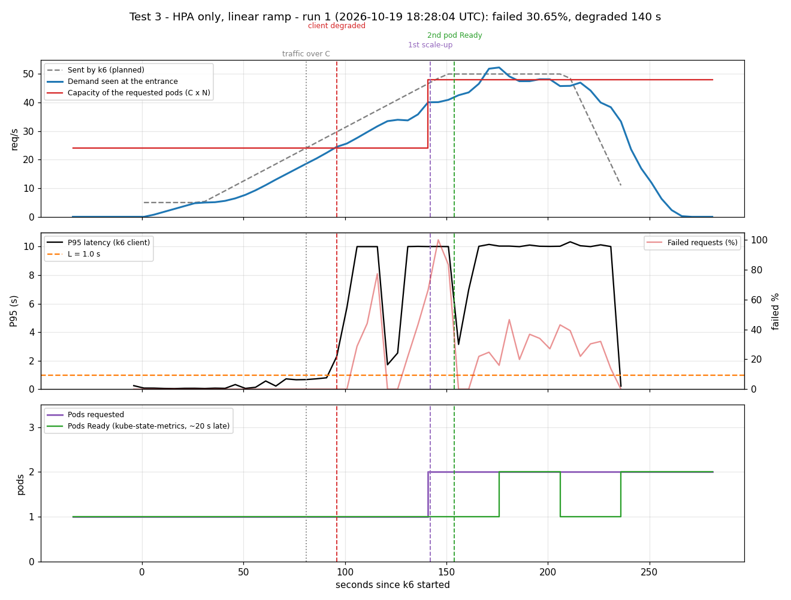

# Prueba 3: el HPA normal, sin Aegis

**Fecha:** 2026-10-19, 18:28:04 – 18:32:45 UTC
**Objetivo:** mostrar que el HPA de siempre escala tarde, con la misma rampa de la [prueba 1](../test1-linear-ramp/).

## Qué se hizo
- El mismo tráfico de la prueba 1 (`kubernetes/load/linear.yaml`): de 5 a 50 req/s en 2 min, 1 min en 50.
- Aegis apagado. HPA de `kubernetes/hpa/baseline.yaml`: escala por CPU al 70%, valores por defecto de Kubernetes.
- Un pod atiende C = 24 req/s: el tráfico lo pasa en el segundo 81.

## Resultados

| Segundo (desde que arrancó k6) | Qué pasó |
|---|---|
| 81 | El tráfico pasa lo que un pod puede atender |
| 96 | El cliente ve el servicio degradado (P95 sobre 1 s) |
| 142 | El HPA pide el 2º pod: **61 s después** de que el tráfico pasó C, 46 s después de que se rompió el servicio |
| 154 | El 2º pod está Ready |
| 145–210 | 50 req/s con 2 pods (2C = 48): sigue sobrecargado, el HPA nunca pide un 3er pod |

k6: 7006 peticiones, **30.65% fallidas**, P95 de 10 s (el timeout del cliente), 140 s degradado.

## Conclusión
El HPA solo reacciona cuando la CPU ya está alta, y el pod nuevo todavía necesita T segundos. Para entonces el servicio ya está roto. Aegis, con la misma rampa, pidió el pod 10 s **antes** de que el tráfico pasara C y falló el 0.77% de las peticiones.

| | Prueba 1 (Aegis) | Prueba 3 (solo HPA) |
|---|---|---|
| 2º pod pedido | segundo 71 (10 s antes de C) | segundo 142 (61 s después de C) |
| 2º pod Ready | segundo 84 | segundo 154 |
| Peticiones fallidas | 0.77% | 30.65% |
| Segundos degradado | 40 | 140 |
| Máximo de pods | 3 | 2 |

Datos: `data/run-1.csv`, `data/run-1-k6.log`, `data/run-1-summary.json`.
