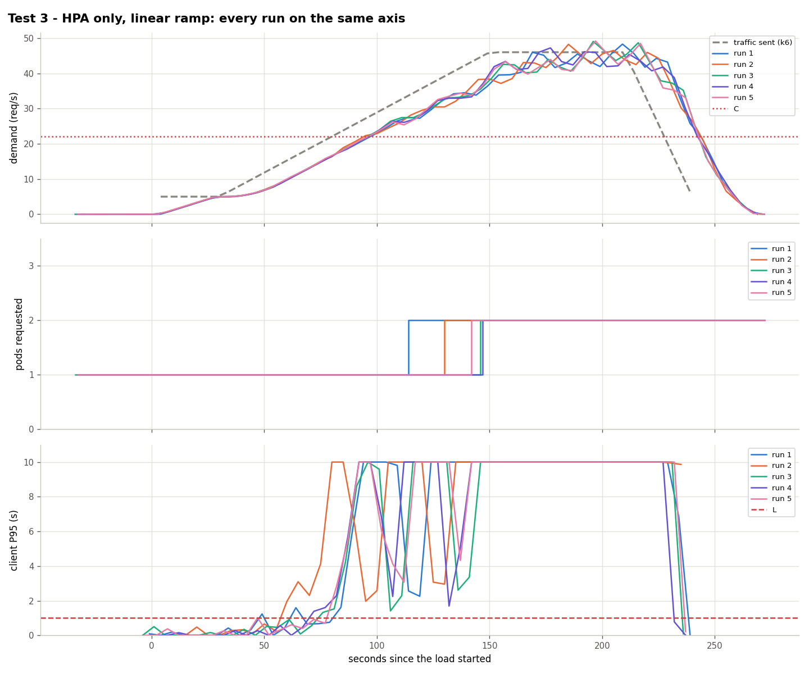
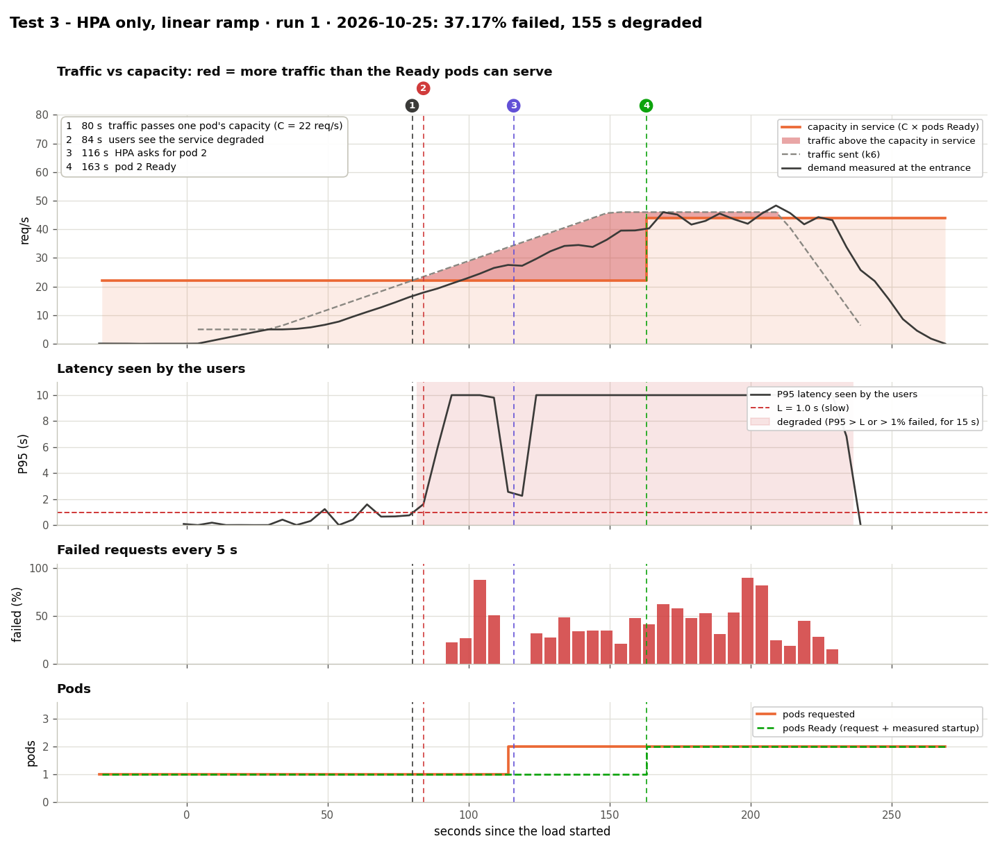

# Test 3: the plain HPA, without Aegis

**Date:** 2026-10-25, 14:40 – 15:12 UTC, 5 runs
**Goal:** show what the usual HPA does with the same ramp as [test 1](../test1-linear-ramp/).

## What was done
- Same traffic as test 1 (`kubernetes/load/linear.yaml`, ×0.917): from 5 to 46 req/s in 2 min, 1 min at 46.
- Aegis off. HPA of `kubernetes/hpa/baseline.yaml`: scale on CPU at 70%, Kubernetes defaults. Every run starts with a freshly created HPA and 1 idle pod.
- One pod serves C = 22 req/s: the traffic passes it at second 80.

## Results

| Run | Degraded from (s) | 2nd pod asked (s) | 2nd pod Ready (s) | Failed | Seconds degraded | Highest pods |
|---|---|---|---|---|---|---|
| 1 | 84 | 116 | 163 | 37.17% | 155 | 2 |
| 2 | 60 | 130 | 178 | 40.08% | 180 | 2 |
| 3 | 76 | 144 | 233 | 35.21% | 160 | 2 |
| 4 | 72 | 145 | 224 | 34.66% | 160 | 2 |
| 5 | 82 | 144 | 233 | 38.48% | 155 | 2 |

The HPA asks for the 2nd pod 36–65 s after the traffic passed C, when the service has already been degraded for 30–70 s. It never asks for a 3rd pod: at 46 req/s the two pods (2C = 44) stay overloaded until the load ends. The client P95 is 10 s (the k6 timeout) in every run.

The new pod is Ready 47–89 s after creation (10–11 s when started before the overload), but it serves earlier: Traefik routes to it before it is Ready and its probe queues behind those requests ([limitations.md](../../limitations.md#pod-startup-under-overload)). Compare request times (116–145 s vs 74 s) and failures.

## Conclusion
The HPA reacts once the CPU is high, after the service broke. Aegis requested the pod 6 s **before** C and failed 2.5% instead of 37.1%, for 2.8 more pod-minutes per run.

Data: `data/` (files per run) and `results.csv`.
