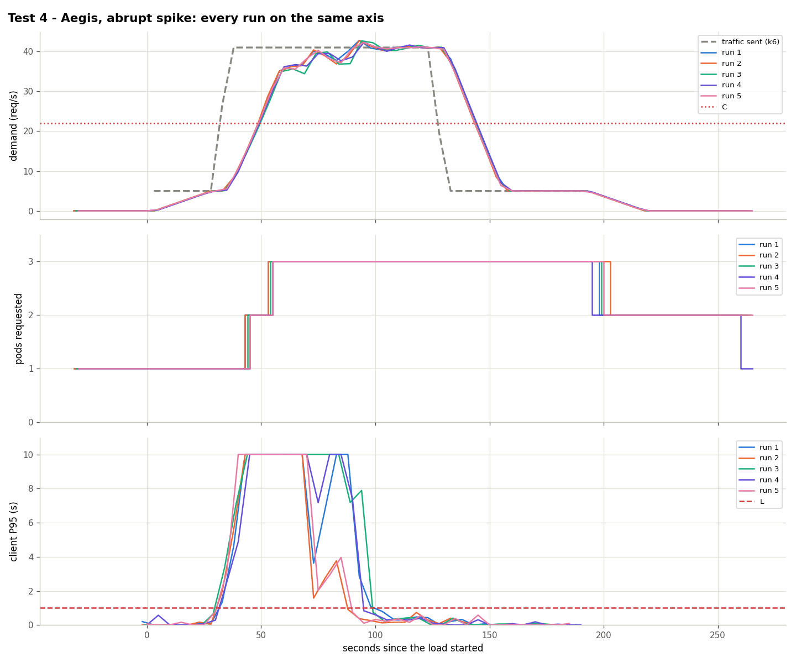

# Test 4: Aegis with an abrupt spike

**Date:** 2026-10-25, 04:17 – 04:43 UTC, 5 runs
**Goal:** a jump with no trend before it (hypothesis H2).

## What was done
- Traffic (`kubernetes/load/spike.yaml`, ×0.917): 30 s at 5 req/s, **5 → 41 req/s in 5 s**, 90 s at 41, 5 s down, 60 s at 5.
- Aegis running with the HPA of `kubernetes/hpa/aegis.yaml`. C = 22 req/s, T = 15 s: the traffic passes C at second 32.5.

## Results

| Run | Scale changes (s since k6 started) | 2nd pod Ready (s) | Failed | Seconds degraded | Pod-minutes |
|---|---|---|---|---|---|
| 1 | 1→2 at 44, 2→3 at 54, 3→2 at 199 | 63 | 12.75% | 70 | 7.83 |
| 2 | 1→2 at 44, 2→3 at 54, 3→2 at 204 | 63 | 11.66% | 55 | 7.87 |
| 3 | 1→2 at 44, 2→3 at 54, 3→2 at 199 | 64 | 16.12% | 65 | 7.87 |
| 4 | 1→2 at 44, 2→3 at 54, 3→2 at 194, 2→1 at 259 | 65 | 13.14% | 60 | 7.83 |
| 5 | 1→2 at 44, 2→3 at 54, 3→2 at 199 | 53 | 12.99% | 55 | 7.87 |

The jump is shorter than T, so no forecaster can be on time. Aegis requests the 2nd pod 11 s after the crossing (two cycles) and the 3rd 10 s later. The 2nd pod took 37–44 s to be Ready in 4 runs ([started under overload](../../limitations.md#pod-startup-under-overload)). The 3rd pod is a **false alarm** every run: 41 req/s fits in 2 pods (44).

## Conclusion
Aegis cannot prevent a spike (13.3% failed) but reacts far earlier than the HPA alone ([test 5](../test5-spike-hpa/): 54.8%), at the cost of one unneeded pod.

Data: `data/` (files per run) and `results.csv`.
