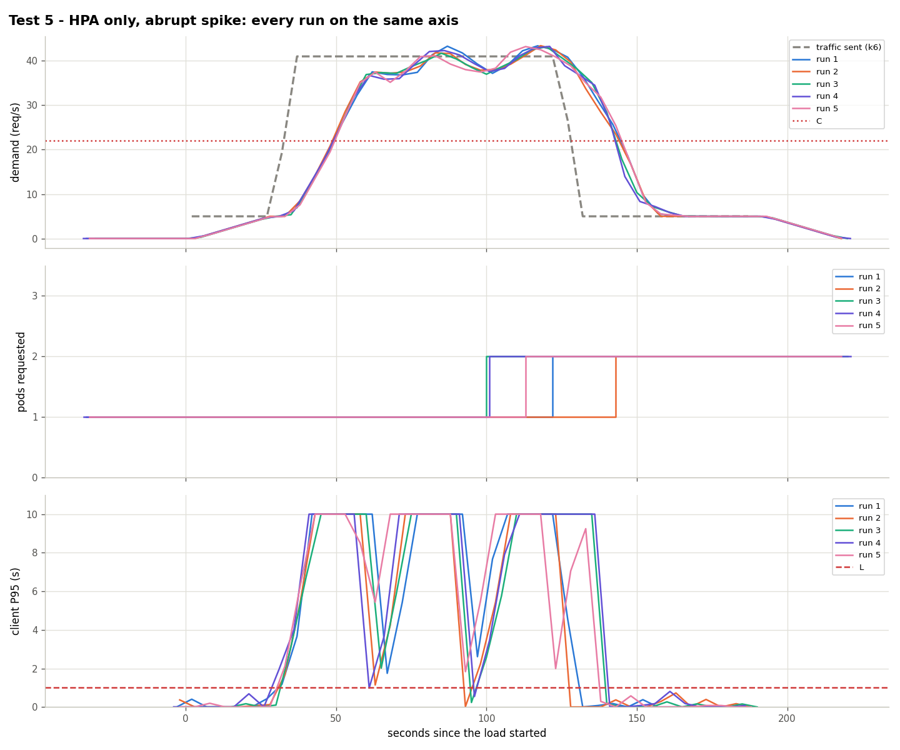

# Test 5: the plain HPA with an abrupt spike

**Date:** 2026-10-25, 15:13 – 15:37 UTC, 5 runs
**Goal:** reference for [test 4](../test4-spike-aegis/).

## What was done
- Same traffic as test 4 (`kubernetes/load/spike.yaml`, ×0.917): 5 → 41 req/s in 5 s at second 30, 90 s at 41.
- Aegis off. HPA of `kubernetes/hpa/baseline.yaml` (CPU 70%), freshly created for every run, 1 idle pod.

## Results

| Run | Scale changes (s since k6 started) | 2nd pod Ready (s) | Failed | Seconds degraded | Pod-minutes |
|---|---|---|---|---|---|
| 1 | 1→2 at 123 | 137 | 52.45% | 100 | 4.28 |
| 2 | 1→2 at 144 | 157 | 61.0% | 100 | 3.93 |
| 3 | 1→2 at 99 | 110 | 53.2% | 105 | 4.68 |
| 4 | 1→2 at 99 | 150 | 55.51% | 110 | 4.68 |
| 5 | 1→2 at 114 | 124 | 51.86% | 105 | 4.43 |

The HPA requests the 2nd pod 67–112 s after the jump, near the end of the spike (it ends at 125 s). In run 2 it came at 144 s, a false alarm.

## Conclusion
Aegis reacts in 11 s instead of 67–112 s: 13.3% failed against 54.8% here.

Data: `data/` (files per run) and `results.csv`.
