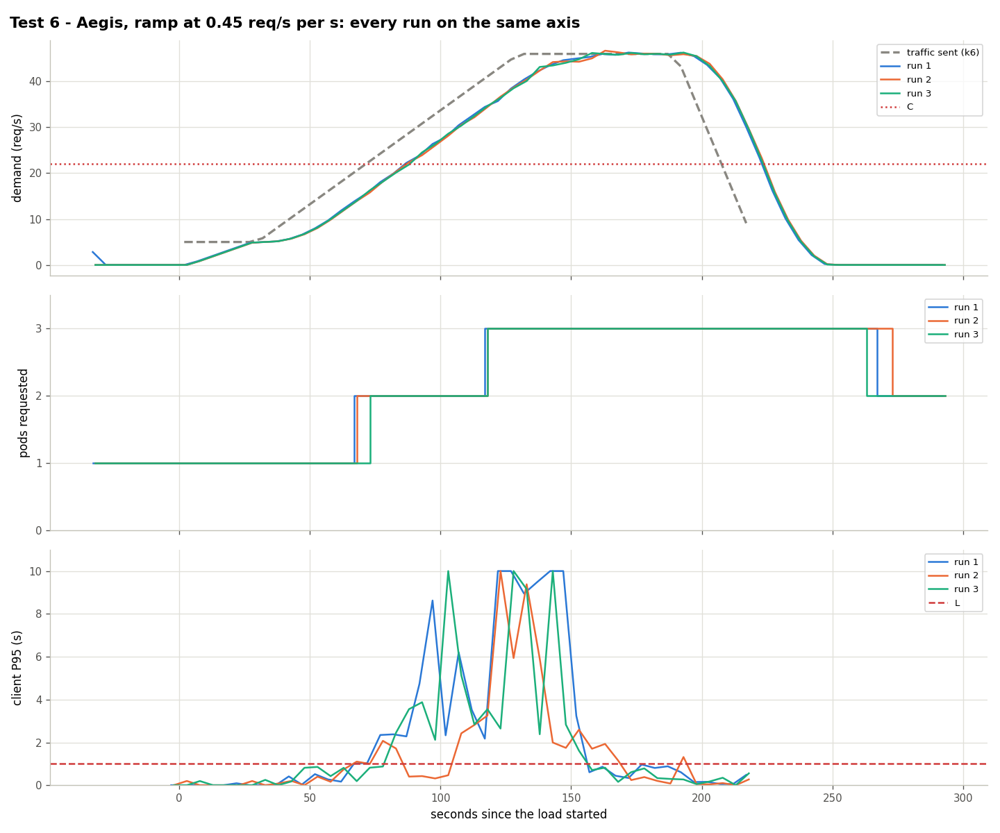

# Test 6: Aegis with a faster ramp (0.41 req/s per s)

**Date:** 2026-10-25, 05:20 – 05:38 UTC, 3 runs
**Goal:** the speed boundary between test 1 (0.34 req/s per s) and the steep waves (0.58).

## What was done
- Traffic (`kubernetes/load/ramp-045.yaml`, ×0.917): 30 s at 5 req/s, 100 s from 5 to 46 req/s, 60 s at 46, 30 s down. Base to C in 41.5 s; the traffic passes C at second 71.5.
- Aegis with the HPA of `kubernetes/hpa/aegis.yaml`.

## Results

| Run | Scale changes (s since k6 started) | 2nd pod Ready (s) | Failed | Seconds degraded | Pod-minutes |
|---|---|---|---|---|---|
| 1 | 1→2 at 69, 2→3 at 119, 3→2 at 269 | 78 | 1.82% | 90 | 7.87 |
| 2 | 1→2 at 69, 2→3 at 119, 3→2 at 274 | 79 | 0.34% | 65 | 7.83 |
| 3 | 1→2 at 74, 2→3 at 119, 3→2 at 264 | 84 | 1.01% | 75 | 7.75 |

The 2nd pod is requested between 2.9 s before and 2.5 s after the crossing, and Ready 7–13 s after it.

## Conclusion
At 0.41 req/s per s Aegis no longer gets ahead of C but keeps failures around 1% ([boundary](../comparison.md#boundary-how-fast-the-traffic-can-rise)).

Data: `data/` (files per run) and `results.csv`.
