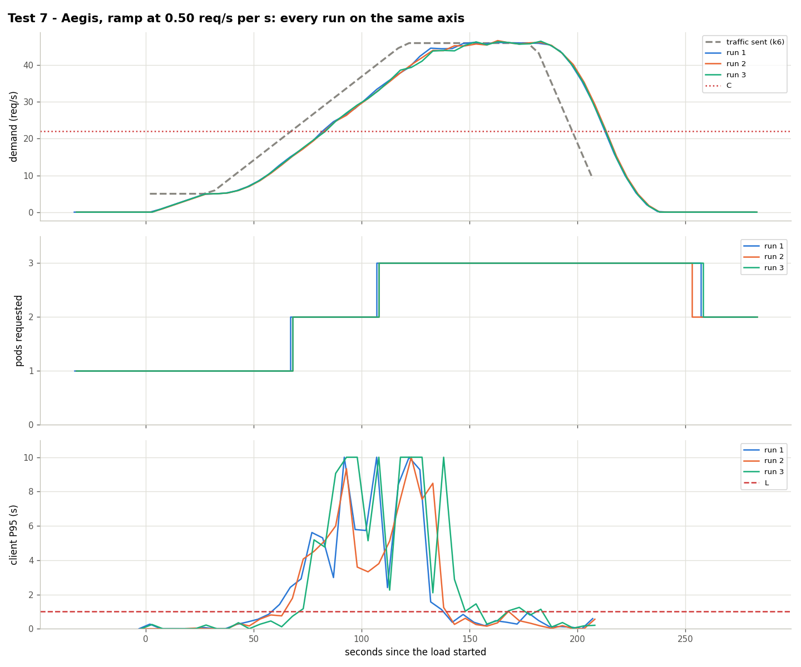

# Test 7: Aegis with a faster ramp (0.46 req/s per s)

**Date:** 2026-10-25, 05:38 – 05:55 UTC, 3 runs
**Goal:** next step of the boundary after [test 6](../test6-ramp-045/).

## What was done
- Traffic (`kubernetes/load/ramp-050.yaml`, ×0.917): 30 s at 5 req/s, 90 s from 5 to 46 req/s, 60 s at 46, 30 s down. Base to C in 37 s; the traffic passes C at second 67.5.
- Aegis with the HPA of `kubernetes/hpa/aegis.yaml`.

## Results

| Run | Scale changes (s since k6 started) | 2nd pod Ready (s) | Failed | Seconds degraded | Pod-minutes |
|---|---|---|---|---|---|
| 1 | 1→2 at 68, 2→3 at 108, 3→2 at 258 | 118 | 1.46% | 80 | 7.53 |
| 2 | 1→2 at 69, 2→3 at 109, 3→2 at 254 | 79 | 0.94% | 75 | 7.53 |
| 3 | 1→2 at 68, 2→3 at 108, 3→2 at 258 | 79 | 2.78% | 85 | 7.53 |

The 2nd pod is requested ~1 s **after** the crossing in all runs; Ready in 11 s, except 50 s in run 1 (started under overload).

## Conclusion
Around 0.46 req/s per s (base to C in ~37 s) prevention ends; failures are still 1–3%.

Data: `data/` (files per run) and `results.csv`.
