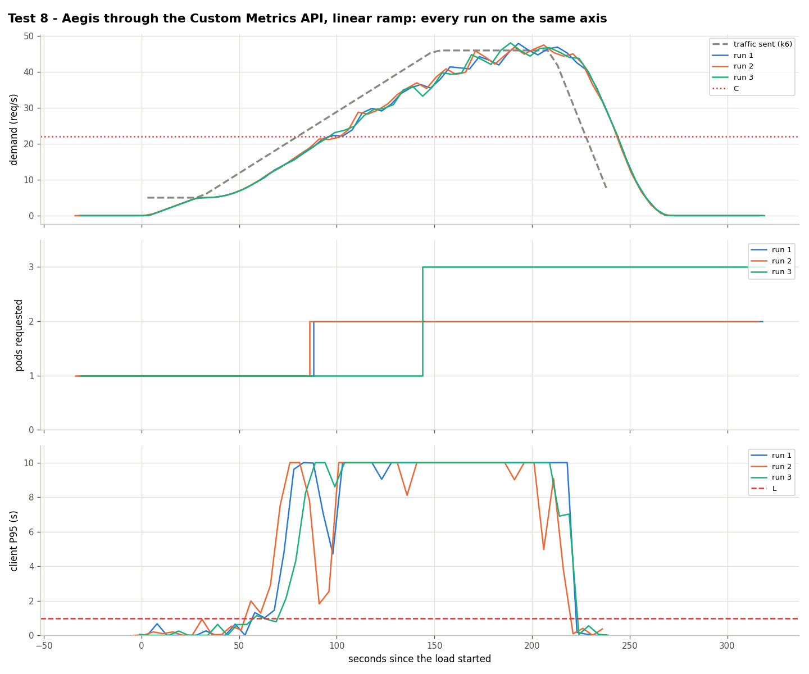

# Test 8: Aegis through the Custom Metrics API

**Date:** 2026-10-25, 05:56 – 06:15 UTC, 3 runs
**Goal:** the HPA reads `aegis_target_replicas` through prometheus-adapter; how much later does it act?

## What was done
- Same traffic as [test 1](../test1-linear-ramp/).
- Aegis running **in the cluster** (`kubernetes/aegis/`, `AEGIS_ACTUATOR_MODE=metric`); HPA of `kubernetes/hpa/aegis-metric.yaml` (Object metric `aegis_target_replicas`, target 1, plus CPU 95%).

## Results

| Run | Scale changes (s since k6 started) | 2nd pod Ready (s) | Failed | Seconds degraded | Pod-minutes |
|---|---|---|---|---|---|
| 1 | 1→2 at 87 | 162 | 21.34% | 165 | 6.55 |
| 2 | 1→2 at 86 | 165 | 18.36% | 165 | 6.57 |
| 3 | 1→3 at 144 | 161 | 20.86% | 150 | 7.2 |

Aegis decides as in test 1 (2nd pod at 72–76 s); the HPA applied it **8.3, 10.6 and 72 s** later. In run 3 the first decision never arrived and the HPA went 1 → 3 at 144 s (cause not identified). Pods were Ready 68–79 s after creation ([started under overload](../../limitations.md#pod-startup-under-overload)).

## Conclusion
The path works but loses the lead: **20.2% failed** against 2.5% in `min_replicas` mode. Use metric mode only if patching HPAs is not allowed, and shorten the path first.

Data: `data/` (files per run) and `results.csv`.
